

  

<h1 align="center">CraftEngineRecipe</h1>

An item and recipe browser for CraftEngine, supporting category navigation, pinyin search, and recipe-usage lookup. CER is more than a recipe book: it can also serve as a complete catalog of CraftEngine items.

> Version 1.2.0-alpha.1 may currently be unstable. Prefer a version published in Releases.

  
  
  
  
  

  <a href="https://github.com/che11111/CraftEngineRecipe/blob/main/README-zh.md">简体中文</a> · <a href="https://che11111.github.io/CraftEngineRecipe-wiki/docs/intro/">User Wiki</a> · <a href="#quick-start">Quick Start</a> · <a href="https://che11111.github.io/CraftEngineRecipe-wiki/docs/guide/troubleshooting/">FAQ</a>

## Demo

<table>
  <tr>
    <td align="center"><strong>Menu Showcase</strong> <small>Item-type layouts and various workstation layouts</small></td>
    <td align="center"><strong>Feature Showcase</strong> <small>Held-item recipes, targeted-block recipes, and search</small></td>
  </tr>
  <tr>
    <td align="center">
      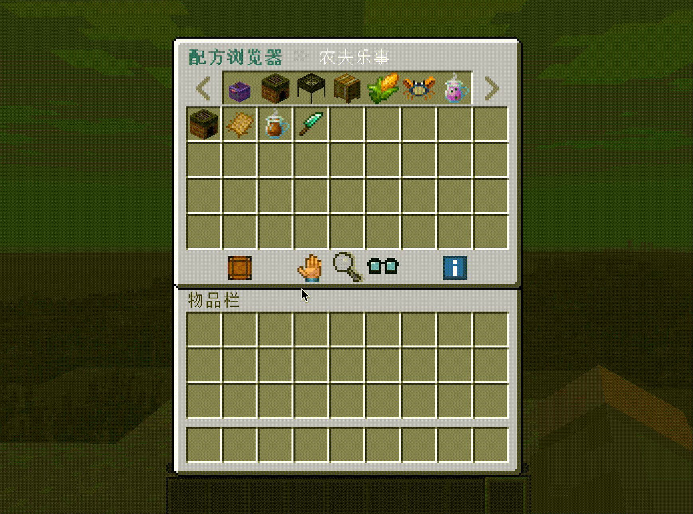
    </td>
    <td align="center">
      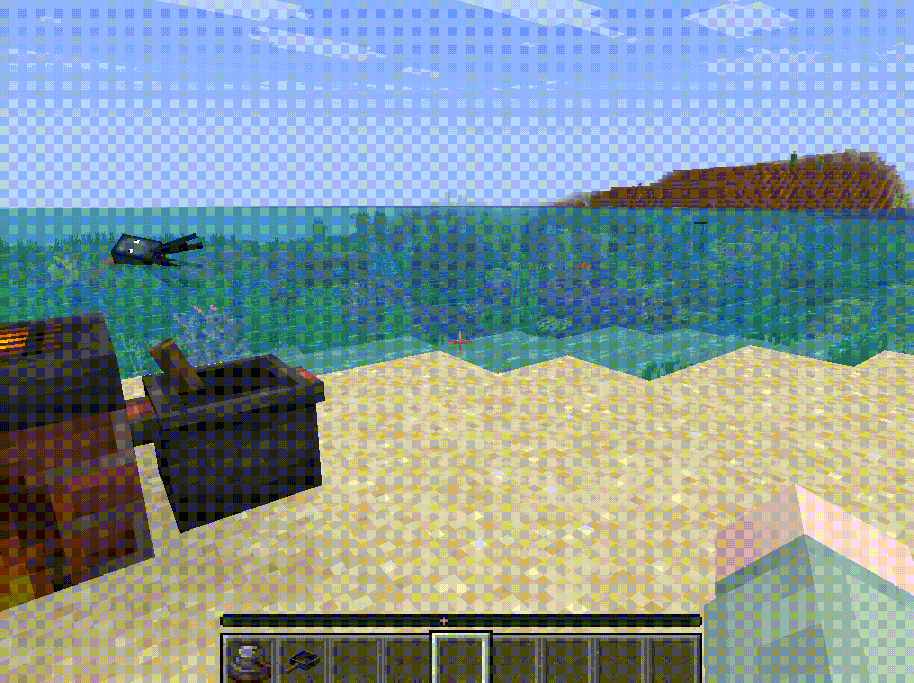
    </td>
  </tr>
</table>

## Menu Interface Styles

CER includes five main menu texture styles. Players can switch between any styles enabled by the server.

<table>
  <thead>
    <tr>
      <td width="20%" align="center">
        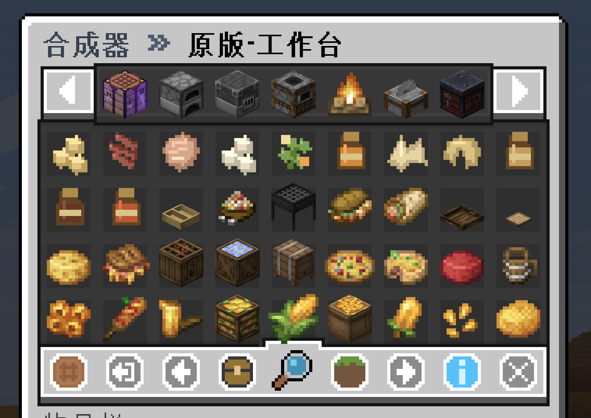
         <small>CER Cute Style Interface</small>
      </td>
      <td width="20%" align="center">
        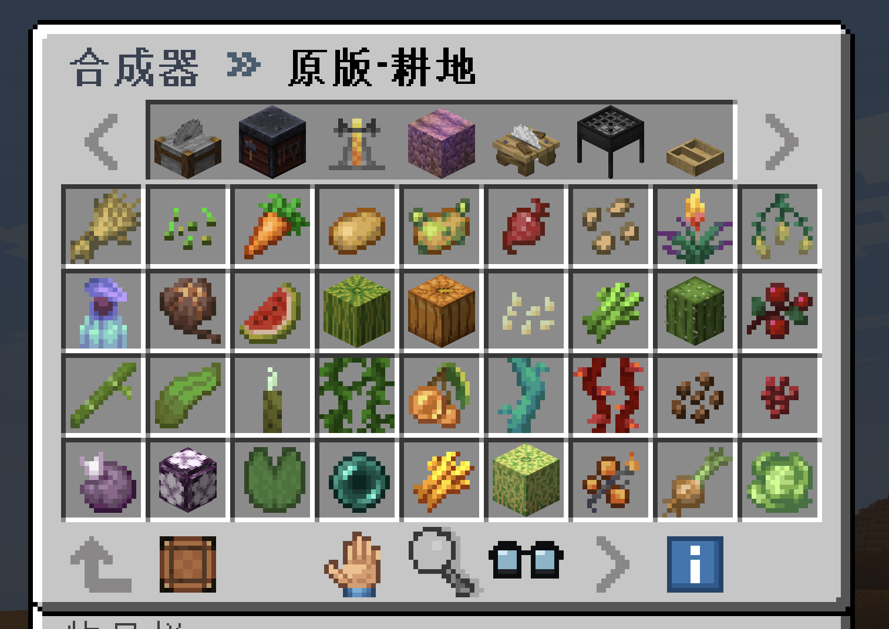
         <small>CER Rough Style Interface</small>
      </td>
      <td width="20%" align="center">
        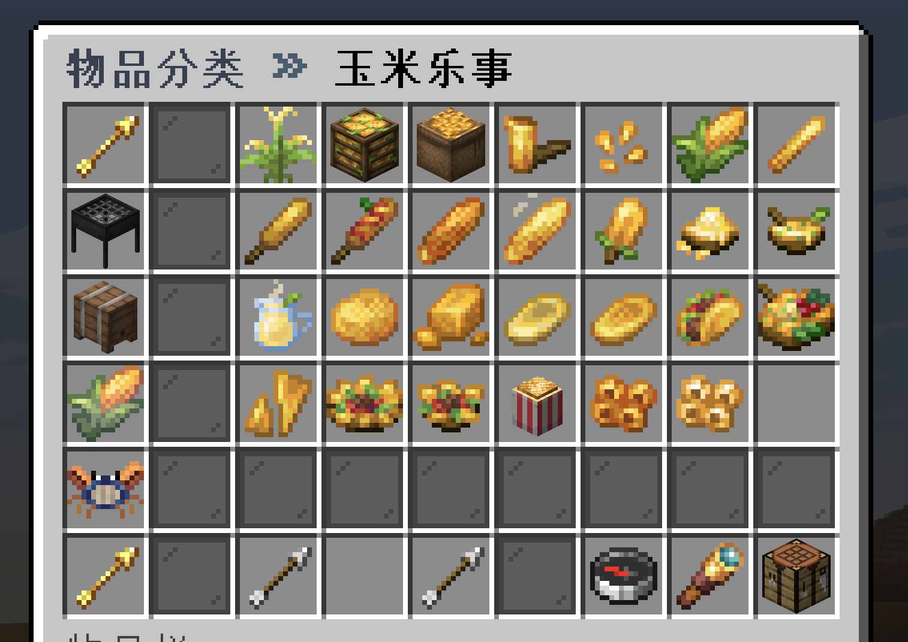
         <small>CER Vanilla Style Interface</small>
      </td>
      <td width="20%" align="center">
        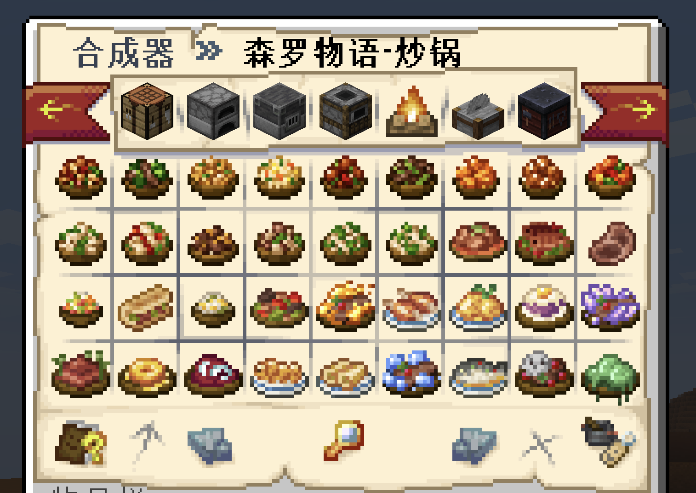
         <small>CER Map Style Interface</small>
      </td>
      <td width="20%" align="center">
        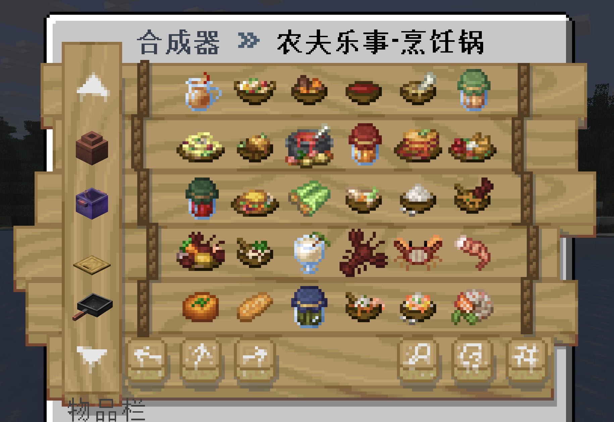
         <small>CER Wood Style Interface</small>
      </td>
    </tr>
  </thead>
</table>

The `CER Cute Style Interface` is the default page.

## Special Integration Textures

Only a selection is shown here. For more CER interface textures, visit the [Screenshot Gallery](https://che11111.github.io/CraftEngineRecipe-wiki/docs/gallery/).

<table>
  <thead>
    <tr>
      <th width="20%" align="center">Farmer's Delight · Skillet</th>
      <th width="20%" align="center">CustomCrops · Planter</th>
      <th width="20%" align="center">Kaleidoscope Cookery · Shawarma Grill</th>
      <th width="20%" align="center">Kaleidoscope Cookery · Millstone</th>
      <th width="20%" align="center">Kaleidoscope Cookery · Teapot</th>
    </tr>
  </thead>
  <tbody>
    <tr>
      <td width="20%" align="center">
        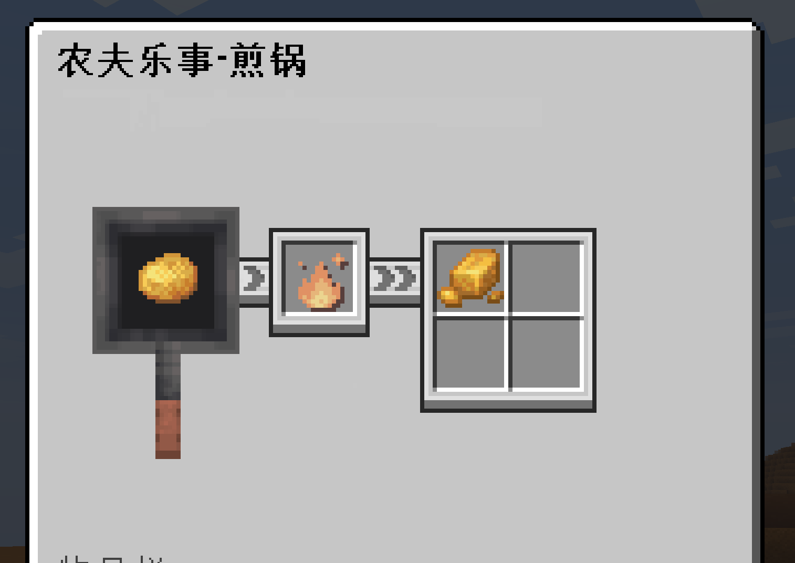
      </td>
      <td width="20%" align="center">
        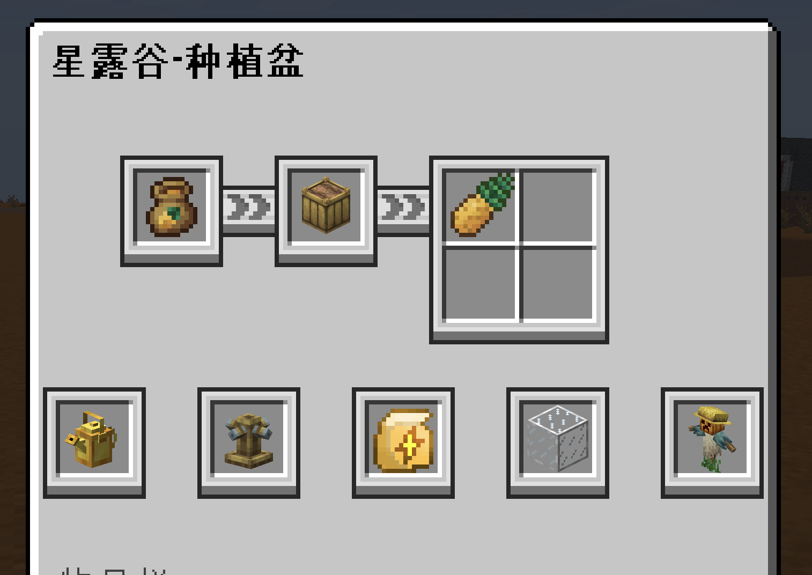
      </td>
      <td width="20%" align="center">
        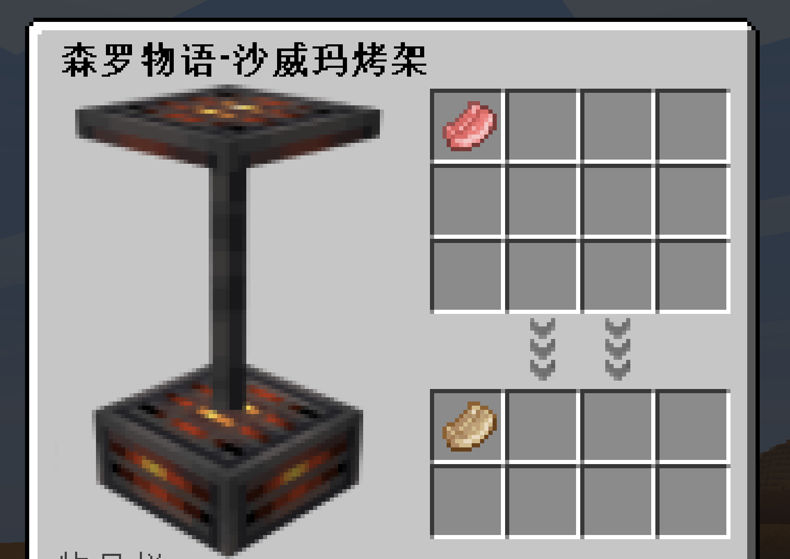
      </td>
      <td width="20%" align="center">
        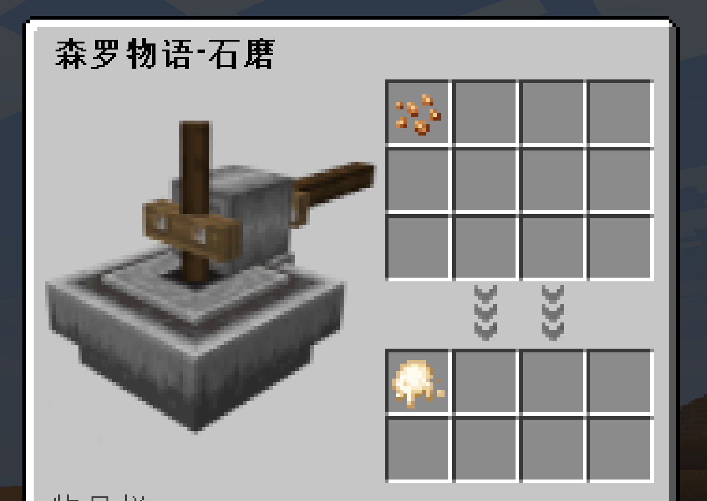
      </td>
      <td width="20%" align="center">
        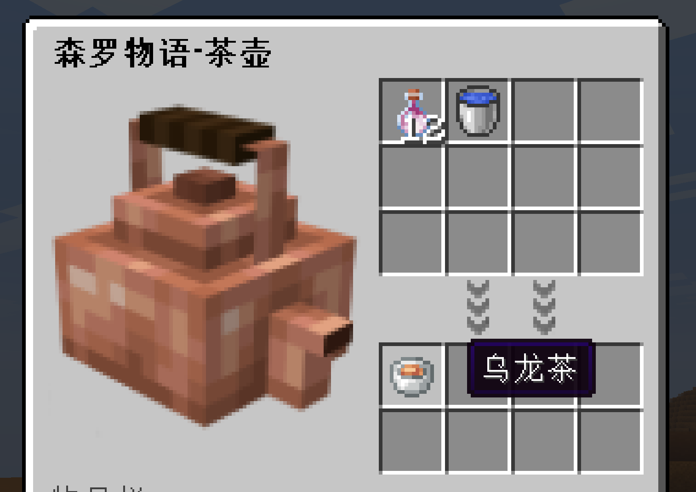
      </td>
    </tr>
  </tbody>
</table>

## Features

- **Ready to use**: automatically installs CraftEngine resources and multiple menu styles, with item-type and workstation browsing.
- **Two-way recipe lookup**: left-click to see how an item is crafted, and right-click to see which recipes use it; supports main-hand, targeted-block, search, and inventory-craftable queries.
- **Fast search**: search by item ID, name, translation key, Chinese pinyin, or pinyin initials.
- **In-game management**: use `/cer manage` to edit categories, visibility permissions, hiding rules, ordering, workstation order, and custom buttons, including moving entries between applied and unapplied configurations.
- **Unified recipe index**: vanilla, CraftEngine, and supported integration recipes can be exported under `recipes/` and browsed together, with automatic reload after file edits; other plugins can also publish through the CER Recipe API.
- **Optional recipe extensions**: Farmer's Delight, Kaleidoscope Cookery, CustomCrops, and private source adapters ship as separate JARs under `plugins/CraftEngineRecipe/extensions/`, so they can be updated without rebuilding the core plugin. Enable them through `/cer integrations`.
- **Config management**: open `config.yml` from `/cer manage` to edit data sources, search limits, hotkeys, and reload behavior in game.
- **Automatic and per-player localization**: CER ships English, Simplified Chinese, Traditional Chinese, Japanese, Korean, German, French, Spanish, and Russian. The server language is detected automatically, and players can choose any of the nine languages in Personalization.
- **Personalization and resume**: players can choose a menu style, landing page, and reopen behavior; preferences and browsing sessions share `player-preferences.db`.

## Specially Integrated Plugins or Content

| Logo | Plugin or content | CER integration |
| :---: | --- | --- |
| <a href="https://github.com/Xiao-MoMi/craft-engine">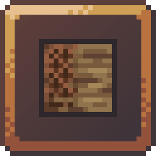</a> | [CraftEngine](https://github.com/Xiao-MoMi/craft-engine) | The core item and recipe source for CER. It reads available CraftEngine recipe types and builds item, result, and usage indexes; required dependency. |
| <a href="https://github.com/IOVEYOUMC0/Farmersdelight-Plugin">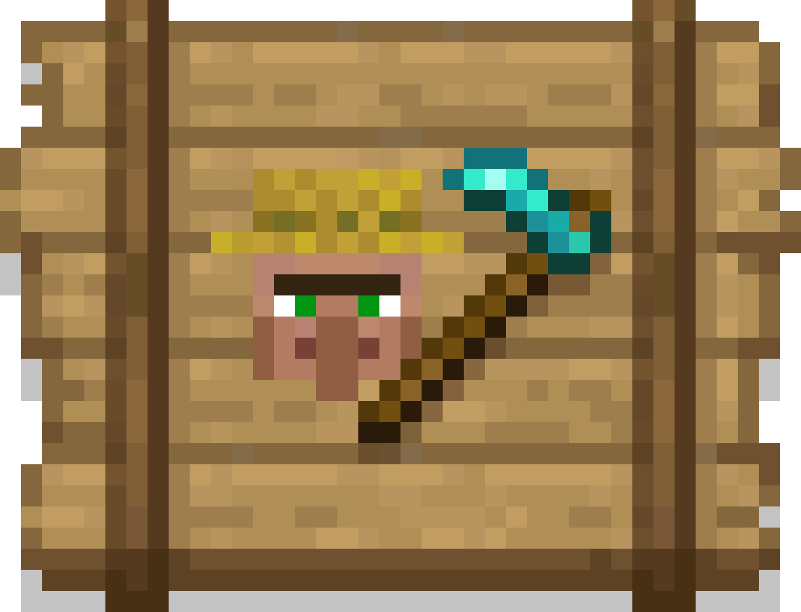</a> | [Farmer's Delight](https://github.com/IOVEYOUMC0/Farmersdelight-Plugin) | Imports cooking pot, cutting board, skillet, and special recipes, with automatic export to CER recipe files. The skillet page uses the dedicated `cer_fd_gui` texture. |
|  | [Kaleidoscope Cookery](https://github.com/Nicoppara/KaleidoscopeCookery_Plugin) | Imports recipes for the pot, chopping board, millstone, shawarma grill, stockpot, steamer, teapot, and other appliances. Each appliance page uses its corresponding dedicated `cer_kc_gui` texture. |
| <a href="https://github.com/Xiao-MoMi/Custom-Crops">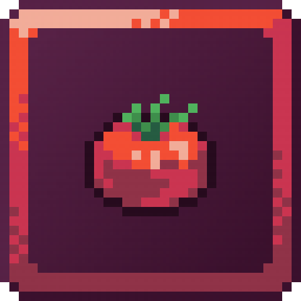</a> | [CustomCrops](https://github.com/Xiao-MoMi/Custom-Crops) | Builds crop pages for CustomCrops pots, including seeds, products, seasons, water, fertilizer, sprinklers, greenhouses, and scarecrows. Pot pages use the dedicated `cer_ccrops_gui` texture. |
| <a href="https://github.com/che11111/WoodworkingSaw">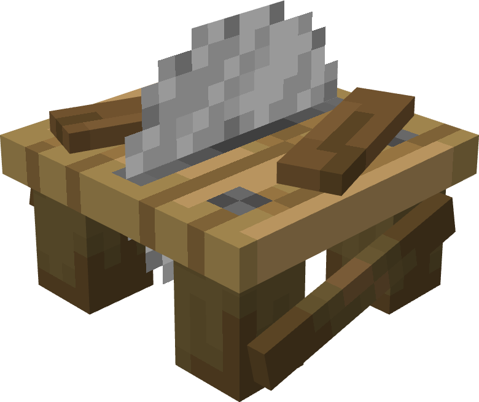</a> | [WoodworkingSaw](https://github.com/che11111/WoodworkingSaw) | Publishes `transformations.yml` transformation rules directly to recipe pages through the CER Recipe API. CER provides the shared `cer_api_gui` UI textures for API recipes. |

> CER provides dedicated recipe UI texture sets for the skillet, Kaleidoscope Cookery appliances, CustomCrops pot pages, and API recipes.

## Requirements

Use Java **21** on Paper **1.21.7 / 1.21.8 / 1.21.9 / 1.21.10 / 1.21.11**, and Java **25** on Paper or Folia **26.1.2 / 26.2 / 26.3**. A compatible **CraftEngine** release is required.

The core uses the CraftEngine **26.8.1** compile API. The bundled `craftengine` and `craftengine-cultivation` source extensions require CraftEngine **26.9.2 or newer**. Core-only browsing and manually managed recipes can continue on the compatible 26.8.1 API; upgrade to 26.9.2+ when using the bundled CE source exporters.

## Quick Start

1. Install compatible versions of CraftEngine and CraftEngineRecipe. Place the core JAR under `plugins/` and the required extensions under `plugins/CraftEngineRecipe/extensions/` using their stable file names, then fully stop and start the server. Do not use `/reload` or plugin-manager hot reloading.

2. As an administrator, run `/cer integrations` to enable CER's special integrations for other plugins or resource packs (for example, Farmer's Delight, Kaleidoscope Cookery, and others; see the compatibility list in this README).

3. As an administrator, run `/cer manage` to adjust categories, ordering, and hiding rules in game. (CER uses a whitelist model: recipes become visible only after an administrator configures them on this page.)

4. Players can run `/cer` or press `Shift+F` to open item categories. They can also use `/cer items`, `/cer craft`, or `/cer search` to open a specific page directly.

## Configuration Guide

[Categories](https://che11111.github.io/CraftEngineRecipe-wiki/docs/guide/categories/) · [Commands](https://che11111.github.io/CraftEngineRecipe-wiki/docs/guide/commands/) · [Search](https://che11111.github.io/CraftEngineRecipe-wiki/docs/guide/search/) · [Menu Styles](https://che11111.github.io/CraftEngineRecipe-wiki/docs/guide/menus/) · [Plugin Integrations](https://che11111.github.io/CraftEngineRecipe-wiki/docs/guide/integrations/) · [Extension Development](https://github.com/che11111/CraftEngineRecipe/blob/main/docs/extensions.md) · [Recipe API](https://che11111.github.io/CraftEngineRecipe-wiki/docs/guide/api/) · [Troubleshooting](https://che11111.github.io/CraftEngineRecipe-wiki/docs/guide/troubleshooting/) · [Updating](https://che11111.github.io/CraftEngineRecipe-wiki/docs/guide/updating/) · [Changelog](https://che11111.github.io/CraftEngineRecipe-wiki/docs/guide/changelog/)

## Usage Statistics

[View usage statistics on bStats](https://bstats.org/plugin/bukkit/CraftEngineRecipe/34772).

## License

The source code of this project is open source under the **GNU General Public License v3.0 (GPL-3.0)**.

Texture files in this project are licensed separately: they are authorized **only for use by the CraftEngineRecipe (CER) plugin**. Without explicit permission, other plugins may not copy, modify, distribute, or reuse the texture files from this project.

## Sponsorship and Support

If this project helps you, you can support development through Ko-fi or Afdian. Sponsors can request plugin installation, configuration, and troubleshooting.

  
  

