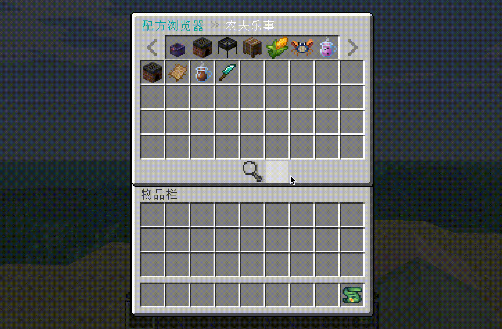
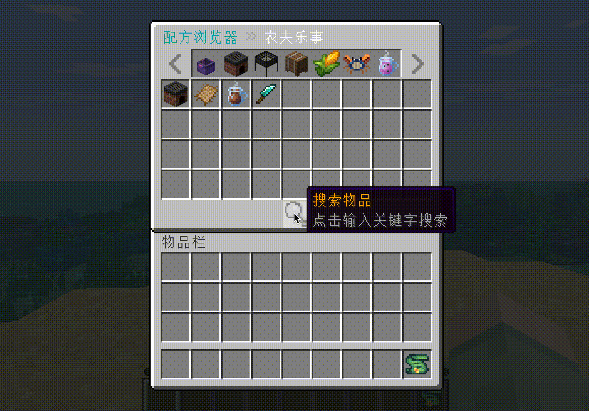

<p align="center">
  
</p>

<h1 align="center">CraftEngineRecipe</h1>

<p align="center">基于 CraftEngine 的物品与配方浏览插件，支持分类浏览、拼音搜索和配方用途查询。</p>

<p align="center">
  
  <a href="WIKI-zh.md#环境要求"></a>
  
  
  <a href="WIKI-zh.md#folia-适配"></a>
</p>

<p align="center">
  <a href="README.md">English</a> · <a href="WIKI-zh.md">使用 Wiki</a> · <a href="#快速上手">快速上手</a> · <a href="WIKI-zh.md#常用调整与故障排查">常见问题</a>
</p>

## 使用演示

<table>
  <tr>
    <td align="center"><strong>页面展示</strong></td>
    <td align="center"><strong>搜索展示</strong></td>
  </tr>
  <tr>
    <td align="center">
      
    </td>
    <td align="center">
      
    </td>
  </tr>
</table>

## 功能与特色

- 自带清晰好用的UI画面，会自动上传至CE资源包目录下。
- 分类浏览与分页，左键查看其配方、右键查看可参与配方。
- 自定义分类顺序、可见权限、隐藏规则，自定义菜单按钮。
- 设置自定义按钮，执行任意指令，以前往其他页面。
- 按物品 ID、名称、翻译键、中文拼音或首字母搜索，支持读取资源包语言文件补全名称。
- 使用 `/cer hand` 查看主手物品的合成来源配方。
- 中英文语言文件，可调整菜单布局、提示文字与音效。
- `Shift+F`快捷键，快速打开配方菜单，可设置启用与否。

## 运行要求

Java **25**、**Paper / Folia**、**CraftEngine**


## 快速上手

1. 安装 CraftEngine 并加载物品、分类和配方，将本插件 JAR 放入 `plugins/` 后启动服务器。

2. 首次运行时，插件会自动将背景与按钮资源安装到 `plugins/CraftEngine/resources/cer_resource/`，（无需手动复制，后续重启或重载不会再次安装）。再通过 CraftEngine 生成并分发资源包（如 `/ce reload all`，以所用版本为准），让客户端接受资源包。详见 [资源包说明](WIKI-zh.md#资源包的应用)。

3. 等待数据就绪，管理员执行 `/cer unapplied` 预览待应用分类。

4. 将 `plugins/CraftEngineRecipe/categories-unapplied.yml` 中需要的命名空间条目复制到 `categories.yml` 的 `entries` 下，例如：

   ```yaml
   entries:
     - id: farmersdelight
       visibility: player
       permission: ''
   ```

   将 `farmersdelight` 换成实际存在的命名空间；已有 `entries` 时追加条目即可。

5. 执行 `/cer reload`，完成后用 `/cer` 或 Shift+F 打开菜单。左键物品查看配方，右键查看可参与配方。


首次正式菜单为空时，请先完成分类应用。详细操作见 [使用 Wiki](WIKI-zh.md)。

## 常用命令

| 命令 | 用途 |
| --- | --- |
| `/cer` | 打开正式菜单，别名 `/cg`、`/browser`、`Shift+F` |
| `/cer search` | 搜索物品 |
| `/cer hand` | 查看主手物品的 CraftEngine 产出配方，遵循正式分类可见范围 |
| `/cer unapplied` | 预览待应用分类（管理员） |
| `/cer reload` | 重载配置与索引（管理员） |

`Shift+F`快捷键默认开启，但可在`config.yml`中关闭

管理权限为 `craftenginerecipe.admin`，OP 默认拥有。

## 配置文档

[分类与权限](WIKI-zh.md#分类权限与隐藏规则) · [隐藏物品](WIKI-zh.md#隐藏某个分类中的物品) · [隐藏分类按钮](WIKI-zh.md#同时隐藏分类入口和分类中的物品) · [自定义按钮](WIKI-zh.md#自定义按钮) · [音效](WIKI-zh.md#菜单音效) · [排障](WIKI-zh.md#常用调整与故障排查) 

## 鸣谢

本项目是对于nsoer的CEGUI-1.0.0.jar项目的二次开发，在此基础上增加了很多功能，感谢nsoer对于代码以及贴图文件的授权。

感谢ChatGPT Astra的帮助，尤其感谢DeepSeek在10月15日的崩溃使我收到了来自他的160元赠金。
