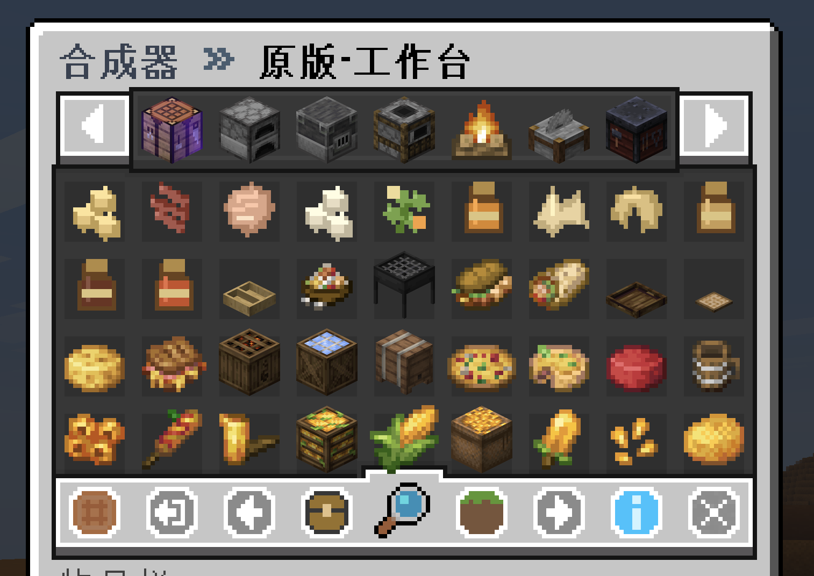
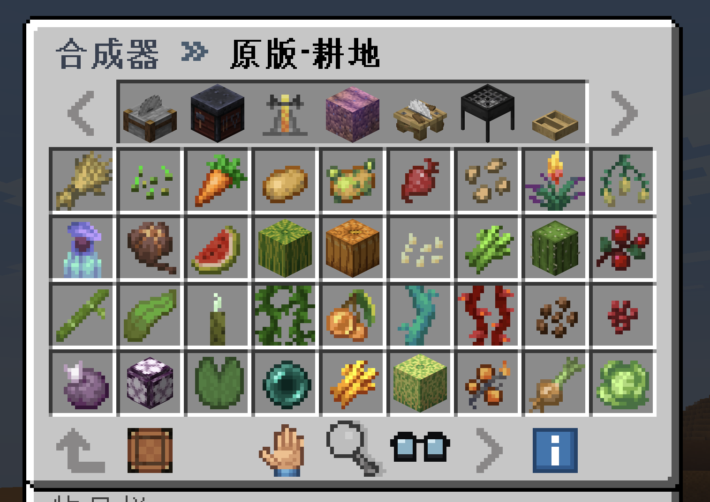
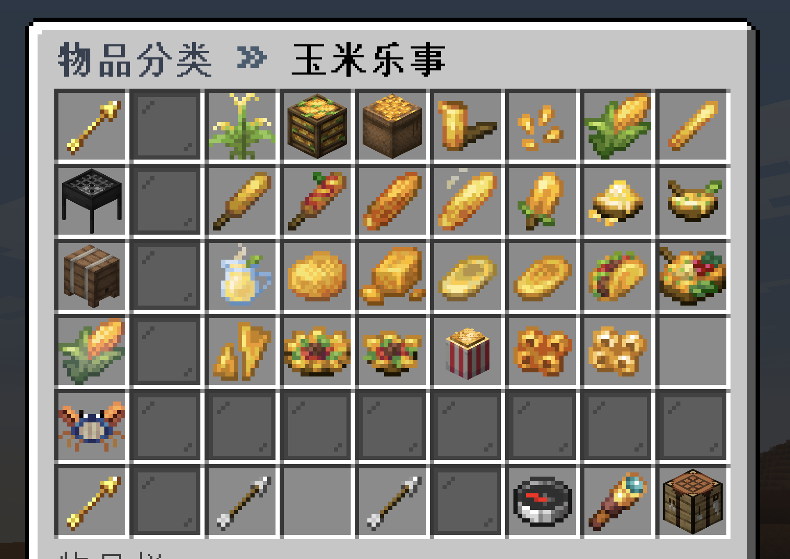
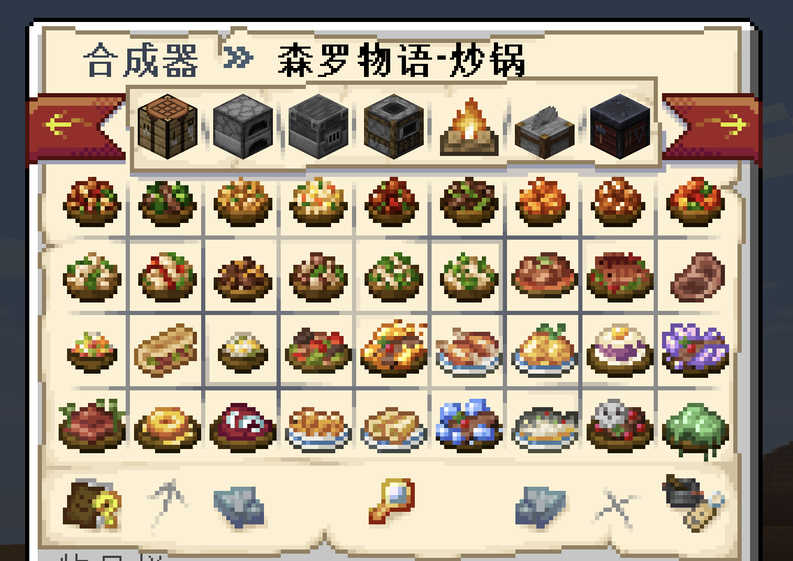
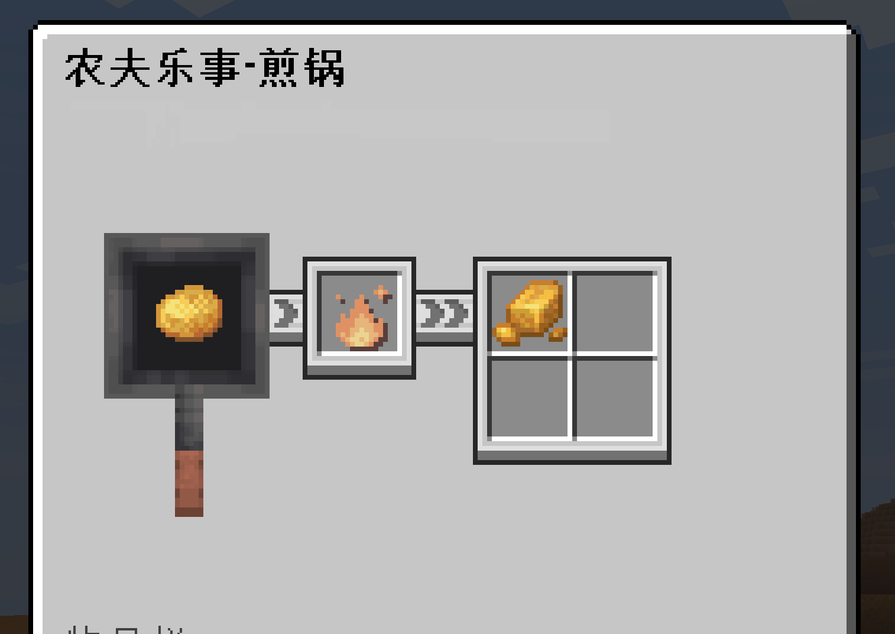
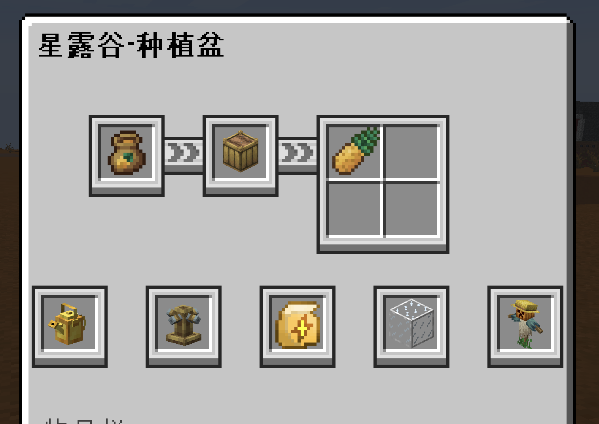
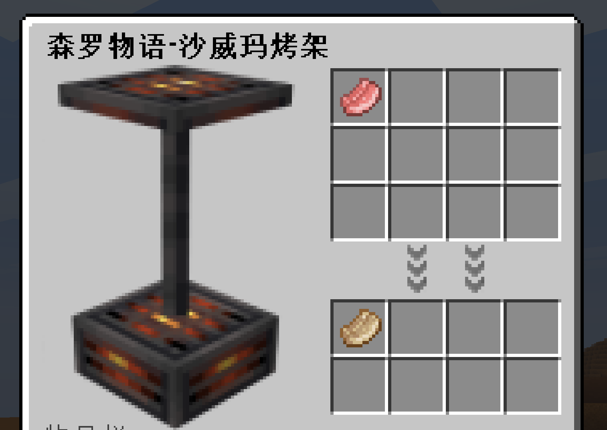
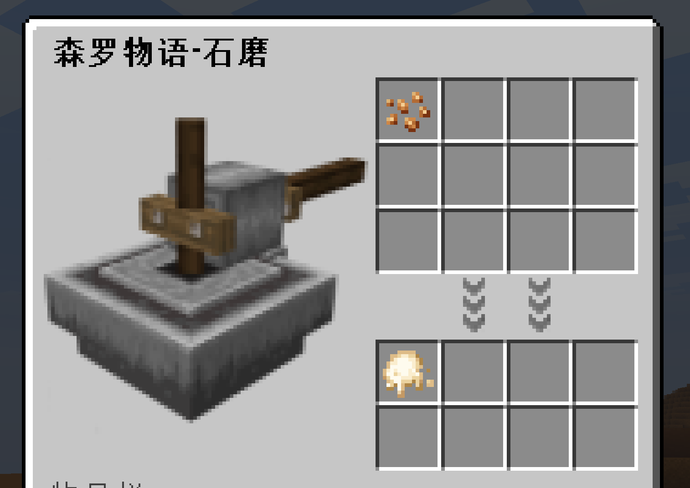
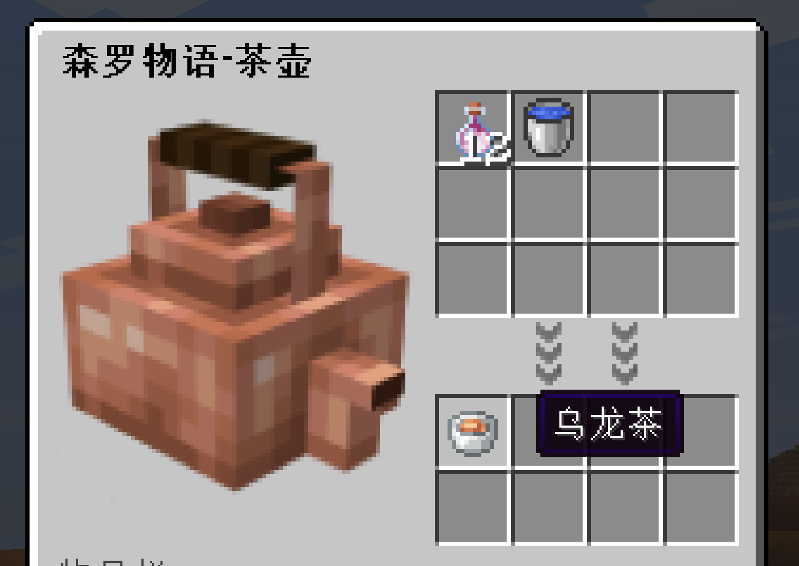

<p align="center">
  
</p>

<h1 align="center">CraftEngineRecipe</h1>

<p align="center">基于 CraftEngine 的物品与配方浏览插件，支持分类浏览、拼音搜索和配方用途查询。CER 不仅是配方书，也可以作为完整的 CE 物品图鉴。</p>

> 目前 1.1.0 版本可能不太稳定。


<p align="center">
  
  <a href="https://che11111.github.io/CraftEngineRecipe-wiki/docs/guide-zh/requirements/"></a>
  
  
  <a href="https://che11111.github.io/CraftEngineRecipe-wiki/docs/guide-zh/requirements/#folia-适配"></a>
</p>

<p align="center">
  <a href="README.md">English</a> · <a href="https://che11111.github.io/CraftEngineRecipe-wiki/docs/intro-zh/">使用 Wiki</a> · <a href="#快速上手">快速上手</a> · <a href="https://che11111.github.io/CraftEngineRecipe-wiki/docs/guide-zh/troubleshooting/">常见问题</a>
</p>

## 使用演示

<table>
  <tr>
    <td align="center"><strong>菜单展示</strong><br><small>按物品种类分类布局与各种合成器分类布局</small></td>
    <td align="center"><strong>功能展示</strong><br><small>查询手持物品配方、准星目标配方与使用搜索框</small></td>
  </tr>
  <tr>
    <td align="center">
      
    </td>
    <td align="center">
      
    </td>
  </tr>
</table>

## 主菜单界面风格

CER 内置四种主菜单贴图风格，玩家可在服务端已启用的样式之间切换。

<table>
  <thead>
    <tr>
      <th width="25%" align="center">CER 可爱风格界面（默认）</th>
      <th width="25%" align="center">CER 粗糙风格界面</th>
      <th width="25%" align="center">CER 原版风格界面</th>
      <th width="25%" align="center">CER 地图风格界面</th>
    </tr>
  </thead>
  <tbody>
    <tr>
      <td width="25%" align="center">
        
        <br><small>默认主菜单风格</small>
      </td>
      <td width="25%" align="center">
        
        <br><small>粗糙风格主菜单</small>
      </td>
      <td width="25%" align="center">
        
        <br><small>原版风格主菜单</small>
      </td>
      <td width="25%" align="center">
        
        <br><small>地图风格主菜单</small>
      </td>
    </tr>
  </tbody>
</table>

## 特殊适配贴图

CER 为部分适配插件中的设备特意绘制了专用配方界面贴图。

<table>
  <thead>
    <tr>
      <th width="20%" align="center">Farmer'sDelight · 煎锅</th>
      <th width="20%" align="center">CustomCrops · 种植盆</th>
      <th width="20%" align="center">KaleidoscopeCookery · 沙威玛烤架</th>
      <th width="20%" align="center">KaleidoscopeCookery · 石磨</th>
      <th width="20%" align="center">KaleidoscopeCookery · 茶壶</th>
    </tr>
  </thead>
  <tbody>
    <tr>
      <td width="20%" align="center">
        
      </td>
      <td width="20%" align="center">
        
      </td>
      <td width="20%" align="center">
        
      </td>
      <td width="20%" align="center">
        
      </td>
      <td width="20%" align="center">
        
      </td>
    </tr>
  </tbody>
</table>

## 功能与特色

- **开箱即用**：自动安装 CraftEngine 资源与多套菜单界面，支持按物品种类、按合成器两种浏览方式。
- **双向配方查询**：左键查看物品如何合成，右键查看物品参与哪些配方；支持主手、准星、搜索和背包可制作查询。
- **快速搜索**：支持物品 ID、名称、翻译键、中文拼音及首字母搜索。
- **游戏内管理**：通过 `/cer manage` 编辑分类、可见权限、隐藏规则、排序、合成器顺序和自定义按钮，并支持正式配置与未应用配置互相移动。
- **统一配方索引**：原版、CraftEngine 和各适配插件的配方可导出到 `recipes/` 后统一浏览，文件修改自动重载；其他插件也可通过 CER Recipe API 接入。
- **插件适配管理**：通过 `/cer integrations` 开启或关闭 CER 对其他插件及资源包的特殊适配。
- **个性化与续接**：玩家可选择菜单风格、默认页面和关闭恢复行为；个性化与浏览会话统一保存在 `player-preferences.db`。

## 特殊适配插件或内容

| Logo | 插件或内容 | CER 适配内容 |
| :---: | --- | --- |
| <a href="https://github.com/Xiao-MoMi/craft-engine"></a> | [CraftEngine](https://github.com/Xiao-MoMi/craft-engine) | CER 的核心物品与配方来源，读取 CE 可用配方类型并提供物品、结果与用途索引；必需前置。 |
| <a href="https://github.com/IOVEYOUMC0/Farmersdelight-Plugin"></a> | [Farmer's Delight](https://github.com/IOVEYOUMC0/Farmersdelight-Plugin) | 导入烹饪锅、砧板、煎锅与特殊配方，并支持自动导出为 CER 配方文件；煎锅页面使用 `cer_fd_gui` 专用贴图。 |
| <a href="https://github.com/Nicoppara/KaleidoscopeCookery_Plugin"></a> | [Kaleidoscope Cookery](https://github.com/Nicoppara/KaleidoscopeCookery_Plugin) | 导入炒锅、砧板、磨盘、沙威玛烤架、高汤锅、蒸笼和茶壶等设备配方；各设备页面使用对应的 `cer_kc_gui` 专用贴图。 |
| <a href="https://github.com/Xiao-MoMi/Custom-Crops"></a> | [CustomCrops](https://github.com/Xiao-MoMi/Custom-Crops) | 生成种植盆作物页面，包含种子、产物、季节、用水、肥料、洒水器、温室和稻草人等信息；种植盆页面使用 `cer_ccrops_gui` 专用贴图。 |
| <a href="https://github.com/che11111/WoodworkingSaw"></a> | [WoodworkingSaw](https://github.com/che11111/WoodworkingSaw) | 通过 CER Recipe API 直接将 `transformations.yml` 转化规则发布到配方页面；CER 为 API 配方准备了统一的 `cer_api_gui` UI 贴图。 |
| <a href="https://github.com/THExuri/Ultramarine-CraftEngine"></a> | [Ultramarine](https://github.com/THExuri/Ultramarine-CraftEngine) | 为 Ultramarine （群青）内容提供命名空间预设；自动隐藏既没有产出配方、也不参与任何合成的物品。 |

> CER 为煎锅、Kaleidoscope Cookery 设备、CustomCrops 种植盆页和 API 配方分别绘制了多套专用配方 UI 贴图。

## 运行要求

Java **25**、Minecraft **26.1.2 / 26.2 / 26.3** 对应的 **Paper / Folia**，以及兼容该服务端的 **CraftEngine**。


## 快速上手

1. 安装兼容版本的 CraftEngine 和 CraftEngineRecipe，并等待服务器启动完成。

2. 管理员执行 `/cer integrations`，开启 CER 对其他插件或资源包的特殊适配（例如农夫乐事、森罗物语等，可见本文适配列表）。

3. 管理员使用 `/cer manage` 在游戏内调整分类、排序和隐藏规则。（CER采用白名单模式，只有管理员在此页面调整后，对应的配方才可显示）

4. 玩家使用 `/cer` 或 `Shift+F` 打开物品分类；也可以使用 `/cer items`、`/cer craft` 和 `/cer search` 直接进入对应页面。

## 配置目录

```text
plugins/CraftEngineRecipe/
├── config.yml                         # 主配置：语言、数据源、提示及浏览默认值
├── integrations.yml                   # CER 特殊适配开关、导出策略和分类预设
├── player-preferences.db              # SQLite：玩家个性化与浏览会话
├── navigation/                        # 正式菜单配置
│   ├── categories.yml                 # 已应用的分类、权限、隐藏规则和按钮
│   ├── categories-unapplied.yml       # 检测到但尚未应用的分类和按钮
│   └── workstations.yml               # 合成器顺序与工作站页自定义按钮
├── example/                           # 示例模板，不会被正式加载
│   ├── navigation/
│   │   └── categories-example.yml     # categories.yml 语法示例
│   └── recipes/
│       └── recipes-example.yml        # 自定义配方文件格式示例
├── lang/                              # 语言文件
│   └── integrations/
│       ├── common/{zh_CN,en_US}.yml             # 通用分隔符、是否文本和单位
│       ├── craftengine/{zh_CN,en_US}.yml        # CraftEngine 合成器名称
│       ├── farmersdelight/{zh_CN,en_US}.yml     # 农夫乐事标题、条件和配方说明
│       ├── kaleidoscope/{zh_CN,en_US}.yml       # 森罗物语设备名称、加工和品质说明
│       ├── customcrops/{zh_CN,en_US}.yml        # 星露谷种植盆、季节、环境和肥料文本
│       ├── cultivation/{zh_CN,en_US}.yml        # 耕地、种子、基质和种植条件说明
│       └── minecraft/{zh_CN,en_US}.yml          # 原版合成器显示名称
├── recipes/                           # CER 实际加载的自定义与导出配方
└── resources/                         # 菜单 UI 本地副本，用于安装到 CE 资源包
```

每个 `cer_menu_*` 菜单包通过 `menu/` 下的完整布局文件声明它负责的页面。文件名任意，代码只读取文件中的 `pages` 声明，不使用继承或合并：

```text
cer_menu_cute/
├── pack.yml                           # CraftEngine 资源包元数据
├── menu/
│   ├── browse.yml                     # 物品分类与按合成器浏览页面布局
│   └── utility.yml                    # 管理、未应用与背包可制作页面布局
├── configuration/gui.yml              # 标题图片的字体高度、基线和贴图引用
└── resourcepack/
    └── assets/cer_cute/textures/font/gui/cer_main.png  # 菜单标题贴图
```

各配方来源导出的标题、Lore 和说明文字统一跟随 `config.yml` 中的 `language`。第三方物品本身的名称仍由 CraftEngine 资源包和客户端语言决定。

## 常用命令

### 玩家指令

| 命令 | 用途 |
| --- | --- |
| `/cer` | 打开正式菜单；快捷键 `Shift+F` |
| `/cer craft` | 直接打开“按合成器分类”页面 |
| `/cer items` | 直接打开“按物品种类分类”页面 |
| `/cer search` | 搜索物品 |
| `/cer hand` | 查看主手原版或 CE 物品的合成配方，遵循已配置的分类限制 |
| `/cer target` | 查看准星所指原版或 CE 方块的合成配方，遵循已配置的分类限制 |
| `/cer open <UI包名>` | 使用指定且已启用的 UI 样式打开菜单 |

### 管理员指令

| 命令 | 用途 |
| --- | --- |
| `/cer integrations` | 打开CER的适配插件列表，并选择是否启用 |
| `/cer manage` | 打开配置管理中心：在游戏内编辑分类、隐藏规则、显示顺序与合成器配置 |
| `/cer unapplied` | 按 `categories-unapplied.yml` 的分类条目打开配方浏览页面 |
| `/cer reload` | 手动重载配置与索引；配方文件修改会自动加载 |
| `/cer menu` | 查看默认、已启用和全部可用样式 |
| `/cer menu enable <包名\|all>` | 启用一个样式或全部 `cer_menu_*` |
| `/cer menu disable <包名>` | 停用非默认样式 |
| `/cer menu default <包名>` | 设置 `/cer` 与 Shift+F 使用的默认样式 |
| `/cer export <craftengine\|farmersdelight\|kaleidoscope\|customcrops\|all>` | 手动重新获取对应来源并替换 `recipes/` 下的数据 |
| `/cer debug recipes` | 将服务器当前注册的全部配方保存为本地 JSON 调试文件 |
| `/cer debug performance` | 查看插件操作耗时、菜单会话/点击计数及服务器 TPS/MSPT |
| `/cer debug performance reset` | 重置插件计时窗口，再复现问题进行观察 |

调试指令也可在控制台执行，管理权限为 `craftenginerecipe.admin`，OP 默认拥有。

## 配置文档

[分类管理](https://che11111.github.io/CraftEngineRecipe-wiki/docs/guide-zh/categories/) · [指令与操作](https://che11111.github.io/CraftEngineRecipe-wiki/docs/guide-zh/commands/) · [配方浏览与搜索](https://che11111.github.io/CraftEngineRecipe-wiki/docs/guide-zh/search/) · [菜单自定义](https://che11111.github.io/CraftEngineRecipe-wiki/docs/guide-zh/menus/) · [插件适配](https://che11111.github.io/CraftEngineRecipe-wiki/docs/guide-zh/integrations/) · [Recipe API](https://che11111.github.io/CraftEngineRecipe-wiki/docs/guide-zh/api/) · [常见问题](https://che11111.github.io/CraftEngineRecipe-wiki/docs/guide-zh/troubleshooting/) · [更新插件](https://che11111.github.io/CraftEngineRecipe-wiki/docs/guide-zh/updating/) · [更新日志](https://che11111.github.io/CraftEngineRecipe-wiki/docs/guide-zh/changelog/)


## 使用统计

[查看 bStats 使用统计](https://bstats.org/plugin/bukkit/CraftEngineRecipe/34772)。

[](https://bstats.org/plugin/bukkit/CraftEngineRecipe/34772)

## 许可证

本项目的源代码采用 **GNU General Public License v3.0（GPL-3.0）** 开源。

本项目中的贴图文件采用单独授权：**仅 CraftEngineRecipe（CER）插件使用**。未经明确许可，其他插件不得复制、修改、分发或复用本项目的贴图文件。

## 鸣谢

感谢 HuiDu_OwO 无偿为本项目绘制了 cer_menu_cute 布局的GUI贴图。

感谢 SnowCutieOwO 为本项目绘制了 cer_menu_map 布局的GUI贴图。

感谢 nsoer 提供的 CEGUI-1.0.0.jar 以及 cer_menu_rough 布局的部分贴图文件的授权。

感谢 ChatGPT Astra 的帮助，尤其感谢 DeepSeek 在10月15日的崩溃使我收到了来自他的160元赠金。
