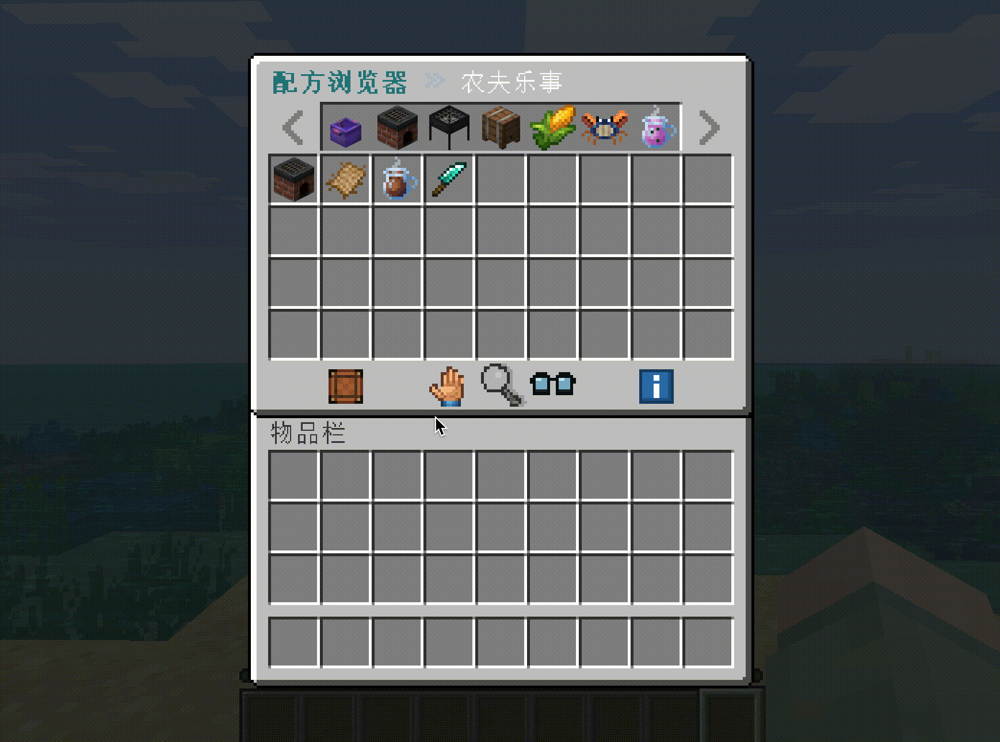
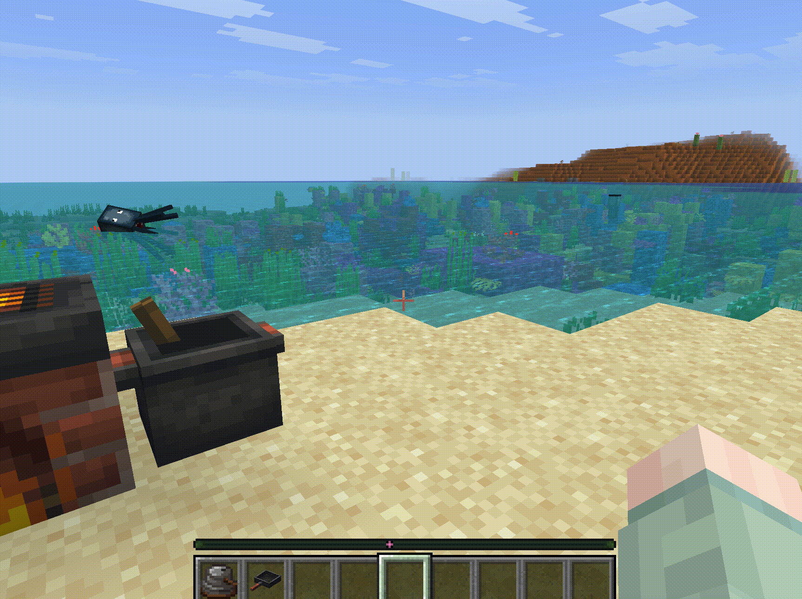
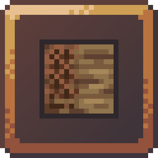

<p align="center">
  
</p>

<h1 align="center">CraftEngineRecipe</h1>

<p align="center">An item and recipe browser for CraftEngine, supporting category navigation, pinyin search, and recipe-usage lookup. CER is more than a recipe book: it can also serve as a complete catalog of CraftEngine items.</p>

> This README describes the unreleased 1.1.0 version. If you are using version 1.0.17, you can refer to the Wiki for its documentation first.


<p align="center">
  
  <a href="https://che11111.github.io/CraftEngineRecipe-wiki/docs/guide/requirements/"></a>
  
  
  <a href="https://che11111.github.io/CraftEngineRecipe-wiki/docs/guide/requirements/#folia-support"></a>
</p>

<p align="center">
  <a href="README-zh.md">简体中文</a> · <a href="https://che11111.github.io/CraftEngineRecipe-wiki/docs/intro/">User Wiki</a> · <a href="#quick-start">Quick Start</a> · <a href="https://che11111.github.io/CraftEngineRecipe-wiki/docs/guide/troubleshooting/">FAQ</a>
</p>

## Demo

<table>
  <tr>
    <td align="center"><strong>Menu Showcase</strong><br><small>Item-type layouts and various workstation layouts</small></td>
    <td align="center"><strong>Feature Showcase</strong><br><small>Held-item recipes, targeted-block recipes, and search</small></td>
  </tr>
  <tr>
    <td align="center">
      
    </td>
    <td align="center">
      
    </td>
  </tr>
</table>

## Features

- **Ready to use**: automatically installs CraftEngine resources and multiple menu styles, with item-type and workstation browsing.
- **Two-way recipe lookup**: left-click to see how an item is crafted, and right-click to see which recipes use it; supports main-hand, targeted-block, search, and inventory-craftable queries.
- **Fast search**: search by item ID, name, translation key, Chinese pinyin, or pinyin initials.
- **In-game management**: use `/cer manage` to edit categories, visibility permissions, hiding rules, ordering, workstation order, and custom buttons, including moving entries between applied and unapplied configurations.
- **Unified recipe index**: vanilla, CraftEngine, and supported integration recipes can be exported under `recipes/` and browsed together, with automatic reload after file edits; other plugins can also publish through the CER Recipe API.
- **Integration management**: enable or disable CER's special integrations for other plugins and resource packs through `/cer integrations`.
- **Personalization and resume**: players can choose a menu style, landing page, and reopen behavior; preferences and browsing sessions share `player-preferences.db`.

## Specially Integrated Plugins or Content

| Logo | Plugin or content | CER integration |
| :---: | --- | --- |
| <a href="https://github.com/Xiao-MoMi/craft-engine"></a> | [CraftEngine](https://github.com/Xiao-MoMi/craft-engine) | The core item and recipe source for CER. It reads available CraftEngine recipe types and builds item, result, and usage indexes; required dependency. |
| <a href="https://github.com/IOVEYOUMC0/Farmersdelight-Plugin"></a> | [Farmer's Delight](https://github.com/IOVEYOUMC0/Farmersdelight-Plugin) | Imports cooking pot, cutting board, skillet, and special recipes, with automatic export to CER recipe files. The skillet page uses the dedicated `cer_fd_gui` texture. |
| <a href="https://github.com/Nicoppara/KaleidoscopeCookery_Plugin"></a> | [Kaleidoscope Cookery](https://github.com/Nicoppara/KaleidoscopeCookery_Plugin) | Imports recipes for the pot, chopping board, millstone, shawarma grill, stockpot, steamer, teapot, and other appliances. Each appliance page uses its corresponding dedicated `cer_kc_gui` texture. |
| <a href="https://github.com/Xiao-MoMi/Custom-Crops"></a> | [CustomCrops](https://github.com/Xiao-MoMi/Custom-Crops) | Builds crop pages for CustomCrops pots, including seeds, products, seasons, water, fertilizer, sprinklers, greenhouses, and scarecrows. Pot pages use the dedicated `cer_ccrops_gui` texture. |
| <a href="https://github.com/che11111/WoodworkingSaw"></a> | [WoodworkingSaw](https://github.com/che11111/WoodworkingSaw) | Publishes `transformations.yml` transformation rules directly to recipe pages through the CER Recipe API. CER provides the shared `cer_api_gui` UI textures for API recipes. |
| <a href="https://github.com/THExuri/Ultramarine-CraftEngine"></a> | [Ultramarine](https://github.com/THExuri/Ultramarine-CraftEngine) | Provides a namespace preset for Ultramarine content and hides items that neither have a result recipe nor participate in any crafting recipe. |

> CER provides dedicated recipe UI texture sets for the skillet, Kaleidoscope Cookery appliances, CustomCrops pot pages, and API recipes.

## Requirements

Java **25**, **Paper / Folia** for Minecraft **26.1.2 / 26.2 / 26.3**, and a compatible **CraftEngine** release.


## Quick Start

1. Install compatible versions of CraftEngine and CraftEngineRecipe, then wait for startup to finish.

2. As an administrator, run `/cer integrations` to enable CER's special integrations for other plugins or resource packs (for example, Farmer's Delight, Kaleidoscope Cookery, and others; see the compatibility list in this README).

3. As an administrator, run `/cer manage` to adjust categories, ordering, and hiding rules in game. (CER uses a whitelist model: recipes become visible only after an administrator configures them on this page.)

4. Players can run `/cer` or press `Shift+F` to open item categories. They can also use `/cer items`, `/cer craft`, or `/cer search` to open a specific page directly.

## Configuration Layout

```text
plugins/CraftEngineRecipe/
├── config.yml                         # Main settings: language, sources, notices, browser defaults
├── integrations.yml                   # CER special integrations, export policies, category presets
├── player-preferences.db              # SQLite preferences and browsing sessions
├── navigation/                        # Active menu configuration
│   ├── categories.yml                 # Applied categories, permissions, hiding rules, buttons
│   ├── categories-unapplied.yml       # Detected categories and buttons not yet applied
│   └── workstations.yml               # Workstation order and page-specific custom buttons
├── example/                           # Example templates; not loaded as live configuration
│   ├── navigation/
│   │   └── categories-example.yml     # Syntax example for categories.yml
│   └── recipes/
│       └── recipes-example.yml        # Custom recipe file format example
├── lang/                              # Language files
│   └── integrations/
│       ├── common/{zh_CN,en_US}.yml             # Shared separators, yes/no text, and units
│       ├── craftengine/{zh_CN,en_US}.yml        # CraftEngine workstation names
│       ├── farmersdelight/{zh_CN,en_US}.yml     # Farmer's Delight titles, conditions, recipe notes
│       ├── kaleidoscope/{zh_CN,en_US}.yml       # Kaleidoscope appliance, processing, and quality text
│       ├── customcrops/{zh_CN,en_US}.yml        # CustomCrops pots, seasons, environments, fertilizer text
│       ├── cultivation/{zh_CN,en_US}.yml        # Cultivation stations, seeds, substrates, planting notes
│       └── minecraft/{zh_CN,en_US}.yml          # Vanilla workstation display names
├── recipes/                           # Custom and exported recipes loaded by CER
└── resources/                         # Local menu resources installed into CraftEngine packs
```

Each `cer_menu_*` menu pack uses complete layout files under `menu/` to declare the pages it handles. File names are arbitrary; CER reads only each file's `pages` declaration and performs no inheritance or merging:

```text
cer_menu_cute/
├── pack.yml                           # CraftEngine resource-pack metadata
├── menu/
│   ├── browse.yml                     # Item-category and workstation browser layouts
│   └── utility.yml                    # Management, unapplied, and craftable-page layouts
├── configuration/gui.yml              # Title-image font height, ascent, and texture reference
└── resourcepack/
    └── assets/cer_cute/textures/font/gui/cer_main.png  # Menu title texture
```

Exported titles, lore, and descriptions follow `language` in `config.yml`. Item names from third-party content remain controlled by the CraftEngine resource pack and the client language.

## Common Commands

### Player Commands

| Command | Purpose |
| --- | --- |
| `/cer` | Open the main menu; shortcut `Shift+F` |
| `/cer craft` | Open the workstation browser directly |
| `/cer items` | Open the item-type browser directly |
| `/cer search` | Search for items |
| `/cer hand` | View recipes producing the vanilla or CraftEngine item in your main hand, respecting configured category restrictions |
| `/cer target` | View recipes producing the vanilla or CraftEngine block under your crosshair, respecting configured category restrictions |
| `/cer open <UI pack>` | Open the menu using the specified enabled UI style |

### Administrator Commands

| Command | Purpose |
| --- | --- |
| `/cer integrations` | Open CER's integration list and choose whether to enable each integration |
| `/cer manage` | Open the Configuration Center to edit categories, hiding rules, ordering, and workstation configuration in game |
| `/cer unapplied` | Browse recipes using category entries from `categories-unapplied.yml` |
| `/cer reload` | Reload configuration and indexes manually; recipe-file edits reload automatically |
| `/cer menu` | Show the default, enabled, and available UI styles |
| `/cer menu enable <pack\|all>` | Enable one style or every `cer_menu_*` |
| `/cer menu disable <pack>` | Disable a non-default style |
| `/cer menu default <pack>` | Set the default style used by `/cer` and Shift+F |
| `/cer export <craftengine\|farmersdelight\|kaleidoscope\|customcrops\|all>` | Re-read the selected source and replace its data under `recipes/` |
| `/cer debug recipes` | Save all recipes currently registered on the server to a local JSON diagnostic file |
| `/cer debug performance` | Show plugin operation timings, menu session/click counts, and server TPS/MSPT |
| `/cer debug performance reset` | Reset the plugin timing window before reproducing a problem |

Debug commands can also be run from the console. The administrator permission is `craftenginerecipe.admin`, which OPs have by default.

## Configuration Guide

[Categories and Permissions](https://che11111.github.io/CraftEngineRecipe-wiki/docs/guide/categories/) · [Hide Items](https://che11111.github.io/CraftEngineRecipe-wiki/docs/guide/categories/#hide-items-and-keep-the-category-button) · [Hide Category Buttons](https://che11111.github.io/CraftEngineRecipe-wiki/docs/guide/categories/#hide-category-buttons-and-contents) · [Custom Buttons](https://che11111.github.io/CraftEngineRecipe-wiki/docs/guide/custom-buttons/) · [Sounds](https://che11111.github.io/CraftEngineRecipe-wiki/docs/guide/menu-sounds/) · [Troubleshooting](https://che11111.github.io/CraftEngineRecipe-wiki/docs/guide/troubleshooting/) · [Updating](https://che11111.github.io/CraftEngineRecipe-wiki/docs/guide/updating/) · [Changelog](https://che11111.github.io/CraftEngineRecipe-wiki/docs/guide/changelog/)


## Usage Statistics

[View usage statistics on bStats](https://bstats.org/plugin/bukkit/CraftEngineRecipe/34772).

[](https://bstats.org/plugin/bukkit/CraftEngineRecipe/34772)

## License

The source code of this project is open source under the **GNU General Public License v3.0 (GPL-3.0)**.

Texture files in this project are licensed separately: they are authorized **only for use by the CraftEngineRecipe (CER) plugin**. Without explicit permission, other plugins may not copy, modify, distribute, or reuse the texture files from this project.

## Credits

Thank you to HuiDu_OwO for drawing the GUI textures used by the `cer_menu_cute` layout for this project without charge.

Thank you to SnowCutieOwO for drawing the GUI textures used by the `cer_menu_map` layout for this project.

Thank you to nsoer for providing CEGUI-1.0.0.jar and for authorizing the use of portions of the `cer_menu_rough` texture assets.

Thank you to ChatGPT Astra for its help, and especially to DeepSeek, whose outage on October 15 resulted in a CNY 160 credit for me.
