<p align="center">
  
</p>

<h1 align="center">CraftEngineRecipe</h1>

<p align="center">An item and recipe browser for CraftEngine, supporting category navigation, pinyin search, and recipe-usage lookup. CER is more than a recipe book: it can also serve as a complete catalog of CraftEngine items.</p>

> Version 1.2.0-alpha4 may currently be unstable. Prefer a version published in Releases.


<p align="center">
  
  <a href="https://che11111.github.io/CraftEngineRecipe-wiki/docs/guide/requirements/"></a>
  
  
  <a href="https://che11111.github.io/CraftEngineRecipe-wiki/docs/guide/requirements/#folia-support"></a>
</p>

<p align="center">
  <a href="README-zh.md">简体中文</a> · <a href="https://che11111.github.io/CraftEngineRecipe-wiki/docs/intro/">User Wiki</a> · <a href="#quick-start">Quick Start</a> · <a href="https://che11111.github.io/CraftEngineRecipe-wiki/docs/guide/troubleshooting/">FAQ</a>
</p>

## Demo

<table>
  <tr>
    <td align="center"><strong>Menu Showcase</strong><br><small>Item-type layouts and various workstation layouts</small></td>
    <td align="center"><strong>Feature Showcase</strong><br><small>Held-item recipes, targeted-block recipes, and search</small></td>
  </tr>
  <tr>
    <td align="center">
      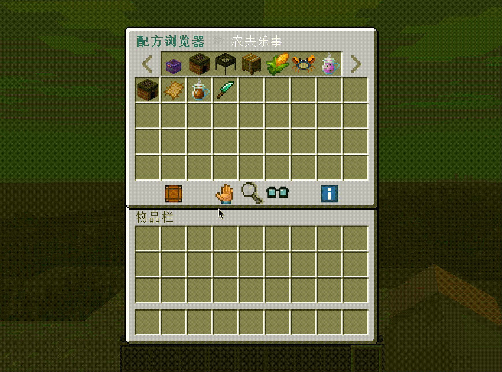
    </td>
    <td align="center">
      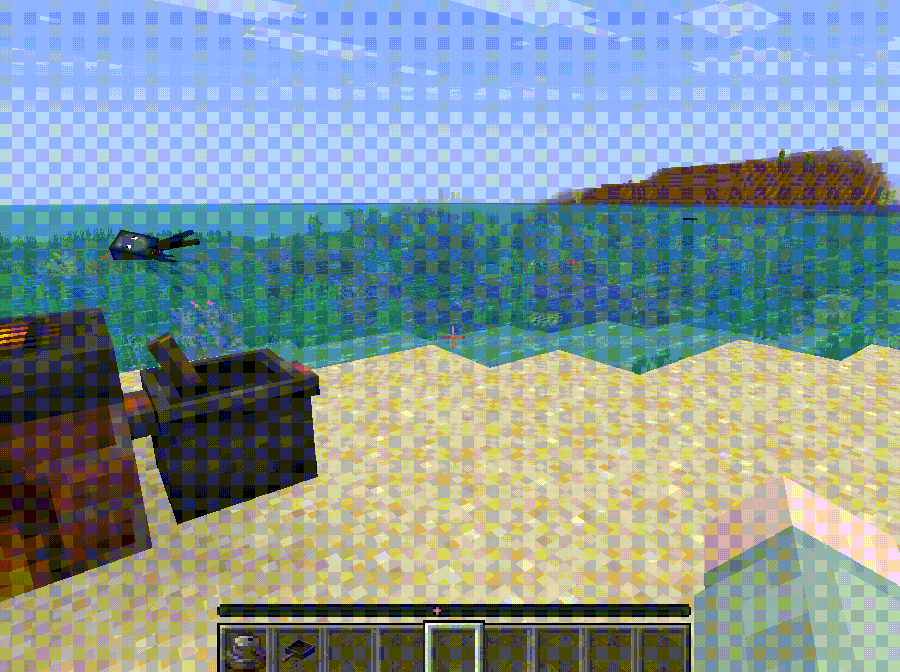
    </td>
  </tr>
</table>

## Menu Interface Styles

CER includes five main menu texture styles. Players can switch between any styles enabled by the server.

<table>
  <thead>
    <tr>
      <td width="20%" align="center">
        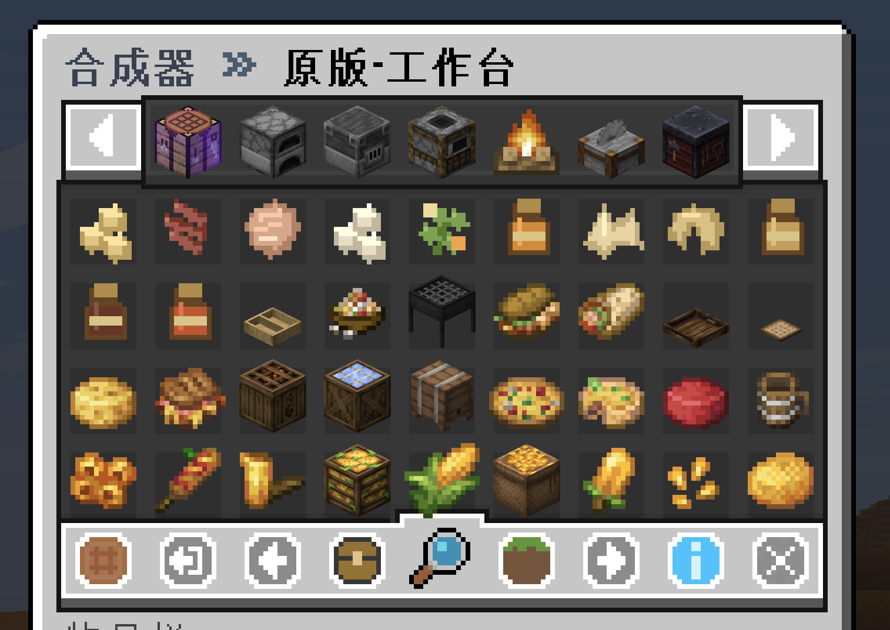
        <br><small>CER Cute Style Interface</small>
      </td>
      <td width="20%" align="center">
        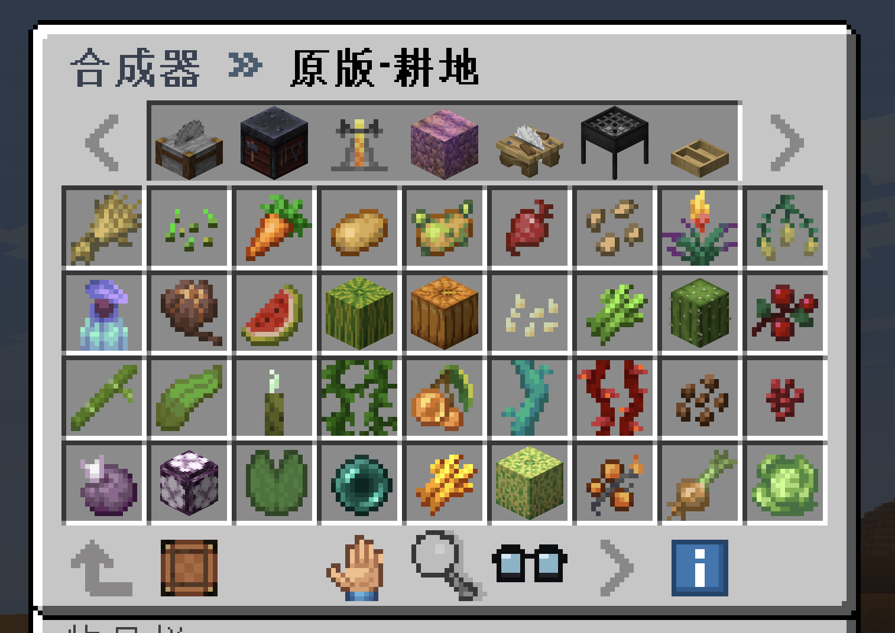
        <br><small>CER Rough Style Interface</small>
      </td>
      <td width="20%" align="center">
        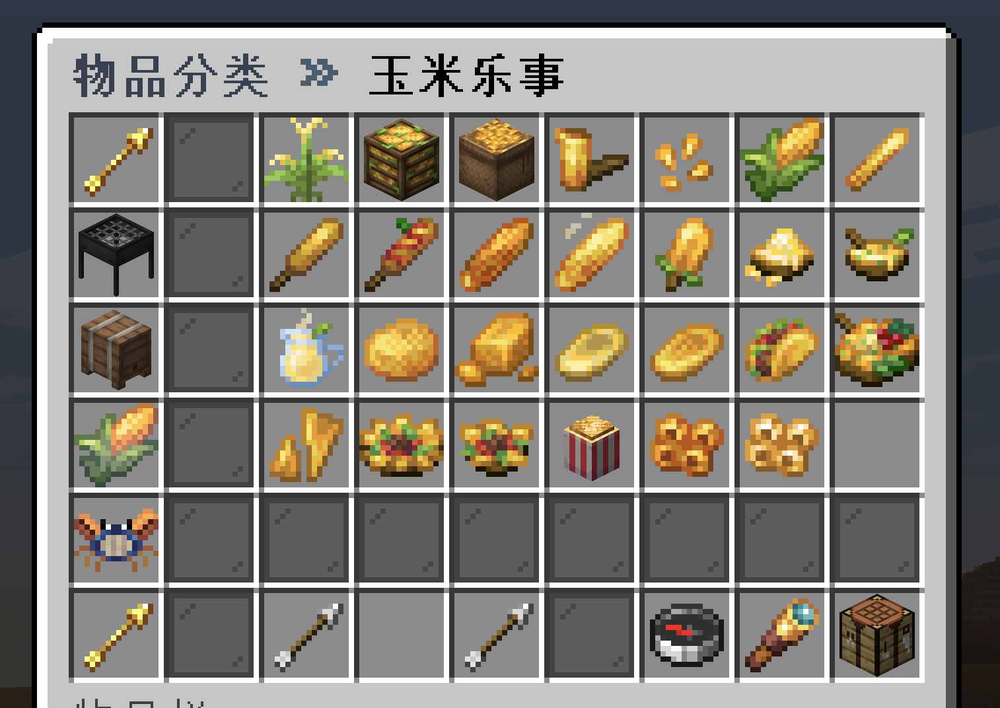
        <br><small>CER Vanilla Style Interface</small>
      </td>
      <td width="20%" align="center">
        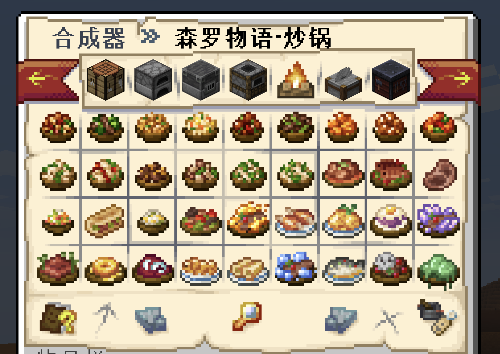
        <br><small>CER Map Style Interface</small>
      </td>
      <td width="20%" align="center">
        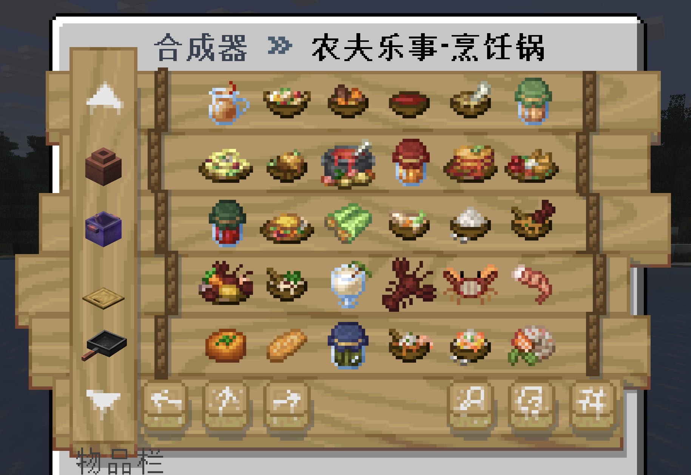
        <br><small>CER Wood Style Interface</small>
      </td>
    </tr>
  </thead>
</table>

The `CER Cute Style Interface` is the default page.

## Special Integration Textures

Only a selection is shown here. For more CER interface textures, visit the [Screenshot Gallery](https://che11111.github.io/CraftEngineRecipe-wiki/docs/gallery/).

<table>
  <thead>
    <tr>
      <th width="20%" align="center">Farmer's Delight · Skillet</th>
      <th width="20%" align="center">CustomCrops · Planter</th>
      <th width="20%" align="center">Kaleidoscope Cookery · Shawarma Grill</th>
      <th width="20%" align="center">Kaleidoscope Cookery · Millstone</th>
      <th width="20%" align="center">Kaleidoscope Cookery · Teapot</th>
    </tr>
  </thead>
  <tbody>
    <tr>
      <td width="20%" align="center">
        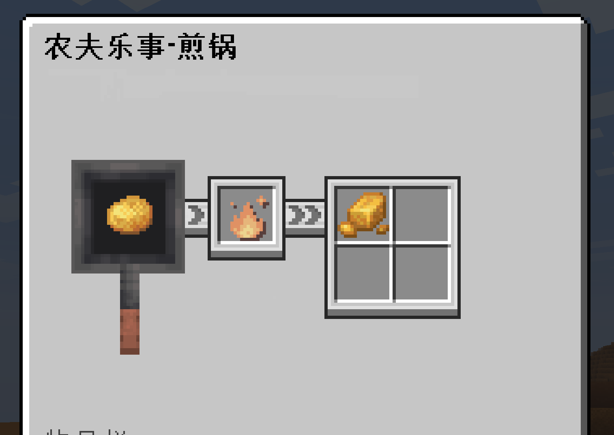
      </td>
      <td width="20%" align="center">
        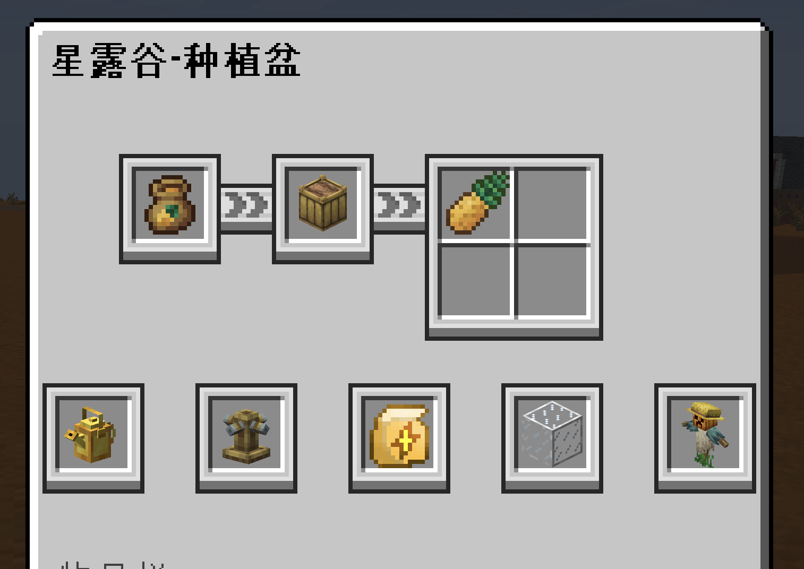
      </td>
      <td width="20%" align="center">
        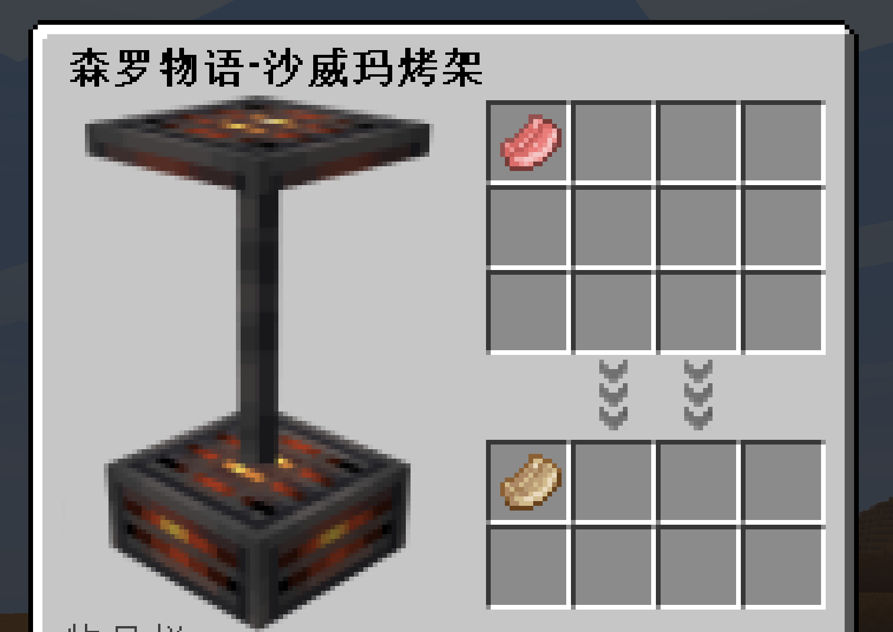
      </td>
      <td width="20%" align="center">
        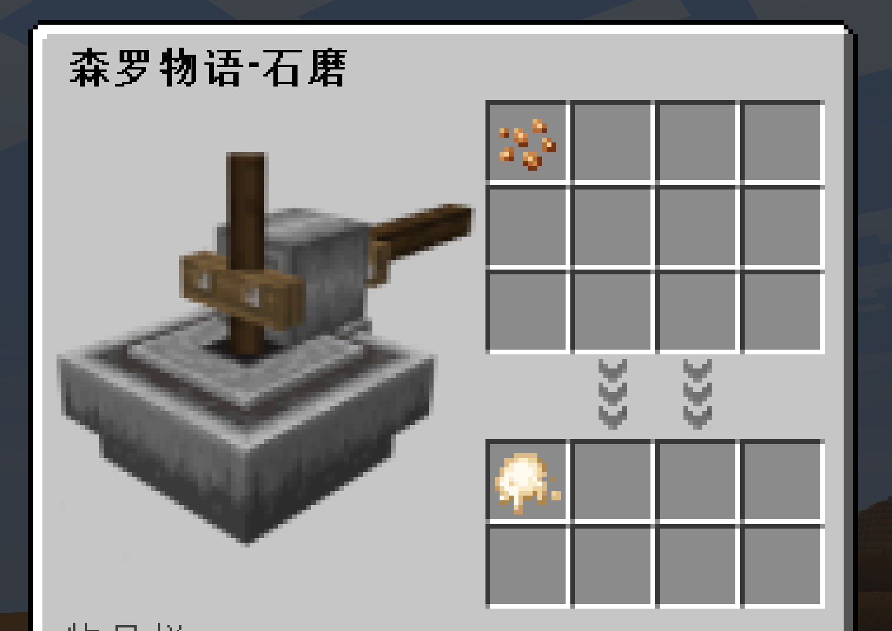
      </td>
      <td width="20%" align="center">
        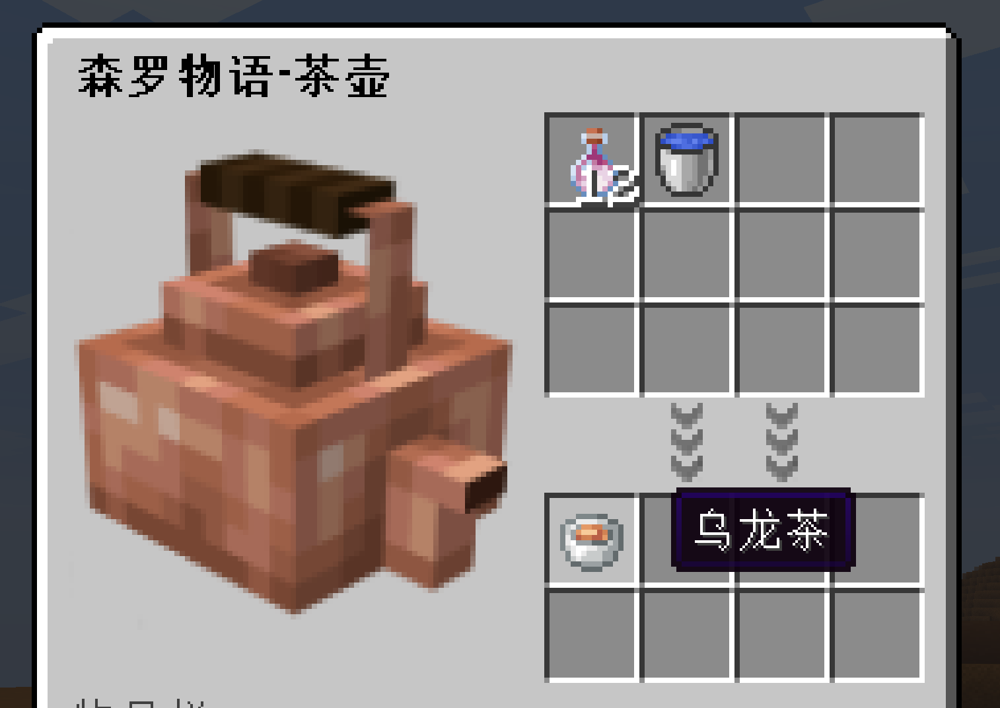
      </td>
    </tr>
  </tbody>
</table>

## Features

- **Ready to use**: automatically installs CraftEngine resources and multiple menu styles, with item-type and workstation browsing.
- **Two-way recipe lookup**: left-click to see how an item is crafted, and right-click to see which recipes use it; supports main-hand, targeted-block, search, and inventory-craftable queries.
- **Fast search**: search by item ID, name, translation key, Chinese pinyin, or pinyin initials.
- **In-game management**: use `/cer manage` to edit categories, visibility permissions, hiding rules, ordering, workstation order, and custom buttons, including moving entries between applied and unapplied configurations.
- **Unified recipe index**: vanilla, CraftEngine, and supported integration recipes can be exported under `recipes/` and browsed together, with automatic reload after file edits; other plugins can also publish through the CER Recipe API.
- **Optional recipe extensions**: Farmer's Delight, Trail & Tales Delight, Kaleidoscope Cookery, CustomCrops, and private source adapters ship as separate JARs under `plugins/CraftEngineRecipe/extensions/`, so they can be updated without rebuilding the core plugin. Enable them through `/cer integrations`.
- **Config management**: open `config.yml` from `/cer manage` to edit data sources, search limits, hotkeys, and reload behavior in game.
- **Automatic and per-player localization**: CER ships English, Simplified Chinese, Traditional Chinese, Japanese, Korean, German, French, Spanish, and Russian. The server language is detected automatically, and players can choose any of the nine languages in Personalization.
- **Personalization and resume**: players can choose a menu style, landing page, and reopen behavior; preferences and browsing sessions share `player-preferences.db`.

## Specially Integrated Plugins or Content

| Logo | Plugin or content | CER integration |
| :---: | --- | --- |
| <a href="https://github.com/Xiao-MoMi/craft-engine"></a> | [CraftEngine](https://github.com/Xiao-MoMi/craft-engine) | The core item and recipe source for CER. It reads available CraftEngine recipe types and builds item, result, and usage indexes; required dependency. |
| <a href="https://github.com/IOVEYOUMC0/Farmersdelight-Plugin"></a> | [Farmer's Delight](https://github.com/IOVEYOUMC0/Farmersdelight-Plugin) | Imports cooking pot, cutting board, skillet, and special recipes, with automatic export to CER recipe files. The skillet page uses the dedicated `cer_fd_gui` texture. |
| <a href="https://github.com/Nicoppara/KaleidoscopeCookery_Plugin"></a> | [Kaleidoscope Cookery](https://github.com/Nicoppara/KaleidoscopeCookery_Plugin) | Imports recipes for the pot, chopping board, millstone, shawarma grill, stockpot, steamer, teapot, and other appliances. Each appliance page uses its corresponding dedicated `cer_kc_gui` texture. |
| <a href="https://github.com/Xiao-MoMi/Custom-Crops"></a> | [CustomCrops](https://github.com/Xiao-MoMi/Custom-Crops) | Builds crop pages for CustomCrops pots, including seeds, products, seasons, water, fertilizer, sprinklers, greenhouses, and scarecrows. Pot pages use the dedicated `cer_ccrops_gui` texture. |
| <a href="https://github.com/che11111/WoodworkingSaw"></a> | [WoodworkingSaw](https://github.com/che11111/WoodworkingSaw) | Publishes `transformations.yml` transformation rules directly to recipe pages through the CER Recipe API. CER provides the shared `cer_api_gui` UI textures for API recipes. |

> CER provides dedicated recipe UI texture sets for the skillet, Kaleidoscope Cookery appliances, CustomCrops pot pages, and API recipes.

## Requirements

Use Java **21** on Paper **1.21.7 / 1.21.8 / 1.21.9 / 1.21.10 / 1.21.11**, and Java **25** on Paper or Folia **26.1.2 / 26.2 / 26.3**. A compatible **CraftEngine** release is required.

The core uses the CraftEngine **26.8.1** compile API. The bundled `craftengine` and `craftengine-cultivation` source extensions require CraftEngine **26.9.2 or newer**. Core-only browsing and manually managed recipes can continue on the compatible 26.8.1 API; upgrade to 26.9.2+ when using the bundled CE source exporters.

## Common Commands

### Player Commands

| Command | Purpose |
| --- | --- |
| `/cer` | Open the main menu; `Shift+F` can be enabled in config |
| `/cer craft` | Open the workstation browser directly |
| `/cer items` | Open the item-type browser directly |
| `/cer search` | Search for items |
| `/cer hand` | View recipes producing the vanilla or CraftEngine item in your main hand, respecting configured category restrictions |
| `/cer target` | View recipes producing the vanilla or CraftEngine block under your crosshair, respecting configured category restrictions |
| `/cer open <UI pack>` | Open the menu using the specified enabled UI style |

### Administrator Commands

| Command | Purpose |
| --- | --- |
| `/cer integrations` | Open the integration list inside CER's management page and choose whether to enable each integration |
| `/cer manage` | Open the Configuration Center to edit categories, hiding rules, ordering, and workstation configuration in game |
| `/cer unapplied` | Browse recipes using category entries from `categories-unapplied.yml` |
| `/cer reload` | Reload configuration, rescan extension JARs, and rebuild indexes; recipe-file edits reload automatically |
| `/cer menu` | Show the default, enabled, and available UI styles |
| `/cer menu enable <pack\|all>` | Enable one style or every `cer_menu_*` |
| `/cer menu disable <pack>` | Disable a non-default style |
| `/cer menu default <pack>` | Set the default style used by `/cer` and Shift+F |
| `/cer export <source-id\|all>` | Re-read a specific extension source and replace its data under `recipes/`; for example, `minecraft_cultivation` or `all` |
| `/cer debug recipes` | Save all recipes currently registered on the server to a local JSON diagnostic file |
| `/cer debug performance` | Show plugin operation timings, menu session/click counts, and server TPS/MSPT |
| `/cer debug performance reset` | Reset the plugin timing window before reproducing a problem |

Debug commands can also be run from the console. The administrator permission is `craftenginerecipe.admin`, which OPs have by default.

## Configuration Guide

[Categories](https://che11111.github.io/CraftEngineRecipe-wiki/docs/guide/categories/) · [Commands](https://che11111.github.io/CraftEngineRecipe-wiki/docs/guide/commands/) · [Search](https://che11111.github.io/CraftEngineRecipe-wiki/docs/guide/search/) · [Menu Styles](https://che11111.github.io/CraftEngineRecipe-wiki/docs/guide/menus/) · [Plugin Integrations](https://che11111.github.io/CraftEngineRecipe-wiki/docs/guide/integrations/) · [Extension Development](docs/extensions.md) · [Recipe API](https://che11111.github.io/CraftEngineRecipe-wiki/docs/guide/api/) · [Troubleshooting](https://che11111.github.io/CraftEngineRecipe-wiki/docs/guide/troubleshooting/) · [Updating](https://che11111.github.io/CraftEngineRecipe-wiki/docs/guide/updating/) · [Changelog](https://che11111.github.io/CraftEngineRecipe-wiki/docs/guide/changelog/)


## Building

Run:

```bash
./build.sh
```

The script builds all four Minecraft targets and the independent extensions:

```text
dist/CraftEngineRecipe-<version>-mc<target>.jar
dist/extensions/cer-ext-*.jar
```

For a single target, select one Maven profile: `mc-1.21.7-1.21.11`, `mc-26.1`, `mc-26.2`, or `mc-26.3`.

## Extension Installation

- **Bundled source extensions**: `cer-ext-craftengine_v<version>.jar`, `cer-ext-craftengine-cultivation_v<version>.jar`, and `cer-ext-minecraft-cultivation_v<version>.jar` are embedded in the core JAR. They are installed automatically only when `plugins/CraftEngineRecipe/extensions/` is created for the first time. Vanilla cultivation data is bundled in the extension and no longer requires extraction from server `lib/*.jar` files; vanilla recipes and nine-language names are exported by the CraftEngine source.
- **Third-party source extensions**: `cer-ext-farmersdelight_v<version>.jar`, `cer-ext-trailtalesdelight_v<version>.jar`, `cer-ext-kaleidoscope_v<version>.jar`, and `cer-ext-customcrops_v<version>.jar`. Enable these only when the corresponding source plugins are installed.
- **Private source template**: `cer-ext-private-alchemy_v<version>.jar` is a development template and does not produce real recipes until its API and capture logic are replaced.


## Quick Start

1. Install compatible versions of CraftEngine and CraftEngineRecipe. Place the core JAR under `plugins/`. On the first run, CER creates `plugins/CraftEngineRecipe/extensions/` and releases its three bundled versioned extensions there. Place any required optional extensions in that directory, then fully stop and start the server. Do not use `/reload` or plugin-manager hot reloading.

2. As an administrator, run `/cer integrations` to enable CER's special integrations for other plugins or resource packs (for example, Farmer's Delight, Kaleidoscope Cookery, and others; see the compatibility list in this README).

3. As an administrator, run `/cer manage` to adjust categories, ordering, and hiding rules in game. (CER uses a whitelist model: recipes become visible only after an administrator configures them on this page.)

4. Players can run `/cer` to open item categories. Administrators can opt in to the `Shift+F` shortcut in config. Players can also use `/cer items`, `/cer craft`, or `/cer search` to open a specific page directly.

## Configuration Layout

```text
plugins/CraftEngineRecipe/
├── extensions/                        # Created on the first run; never repaired automatically once it exists
│   ├── cer-ext-craftengine_v<version>.jar        # Released from the core JAR on first run
│   ├── cer-ext-craftengine-cultivation_v<version>.jar
│   ├── cer-ext-minecraft-cultivation_v<version>.jar    # Released from the core JAR on first run
│   ├── cer-ext-farmersdelight_v<version>.jar
│   ├── cer-ext-trailtalesdelight_v<version>.jar
│   ├── cer-ext-kaleidoscope_v<version>.jar
│   ├── cer-ext-customcrops_v<version>.jar
│   └── cer-ext-private-alchemy_v<version>.jar
├── extensions-data/                   # Extension data, source-directory ownership, and version markers
├── config.yml                         # Main settings: menus, search, hotkeys, updates, browser defaults
├── resources/cer_menu_*/lang/         # Per-menu-pack text overrides for all nine languages
├── integrations.yml                   # CER special integrations, export policies, category presets
├── player-preferences.db              # SQLite preferences and browsing sessions
├── navigation/                        # Active menu configuration
│   ├── categories.yml                 # Applied categories, permissions, hiding rules, buttons
│   ├── categories-unapplied.yml       # Detected categories and buttons not yet applied
│   └── workstations.yml               # Workstation order and page-specific custom buttons
├── example/                           # Example templates; not loaded as live configuration
│   ├── navigation/
│   │   └── categories-example.yml     # Syntax example for categories.yml
│   └── recipes/
│       └── recipes-example.yml        # Custom recipe file format example
├── lang/                              # Language files
│   └── integrations/
│       ├── craftengine/{<locale>}.yml           # CraftEngine workstation names
│       ├── farmersdelight/{<locale>}.yml        # Farmer's Delight titles, conditions, recipe notes
│       ├── kaleidoscope/{<locale>}.yml          # Kaleidoscope appliance, processing, and quality text
│       ├── customcrops/{<locale>}.yml           # CustomCrops pots, seasons, environments, fertilizer text
│       ├── cultivation/{<locale>}.yml           # Cultivation stations, seeds, substrates, planting notes
│       ├── minecraft/{<locale>}.yml             # Vanilla workstation display names
│       └── private_alchemy/{<locale>}.yml       # Private source template text
├── recipes/                           # Custom and exported recipes loaded by CER
└── resources/                         # Local core and extension resources merged into CraftEngine packs
```

Each managed resource directory contains `.cer-resource-state.yml`, recording its owner JAR version and file hashes. Normal restarts preserve local edits; upgrades only replace files that still match the previous bundled version and remove obsolete files only when they were not edited. The resulting `CraftEngine/resources/CraftEngineRecipe/subpacks/` contains both core menu packs and extension-declared UI packs.

Language files declared through an extension's `language-source` are released under `lang/integrations/<language-source>/<locale>.yml`; extensions sharing a language source share that on-disk text. Runtime always reads the on-disk copy. Upgrades only add missing keys without overwriting edits made by players or server owners. Extension-generated titles, notes, conditions, and parameterized text are resolved using the opening player's language.

Each `cer_menu_*` menu pack uses complete layout files under `menu/` to declare the pages it handles. File names are arbitrary; CER reads only each file's `pages` declaration and performs no inheritance or merging:

```text
cer_menu_cute/
├── pack.yml                           # CraftEngine resource-pack metadata
├── menu/
│   ├── browse.yml                     # Item-category and workstation browser layouts
│   └── utility.yml                    # Management, unapplied, and craftable-page layouts
├── configuration/gui.yml              # Title-image font height, ascent, and texture reference
└── resourcepack/
    └── assets/cer_cute/textures/font/gui/cer_main.png  # Menu title texture
```

The supported locale IDs are `en_US`, `zh_CN`, `zh_TW`, `ja_JP`, `ko_KR`, `de_DE`, `fr_FR`, `es_ES`, and `ru_RU`. The plugin UI, dialogs, status messages, menu labels, vanilla item names, and resource-pack-backed names follow each player's selected language. CraftEngine item names are resolved from the item definition's translation key in the corresponding CraftEngine locale data. Bundled vanilla recipe files are language-neutral: stable workstation IDs are localized at runtime, and official client translations for all nine locales are bundled.

Item names fall back in this order: player locale, English, then a readable name derived from the item ID. Raw `item.*` and `block.*` translation keys are never shown as item names. Vanilla recipe names are read from the generated CraftEngine resource pack in all nine supported locales; vanilla cultivation remains version-specific.


## Usage Statistics

[View usage statistics on bStats](https://bstats.org/plugin/bukkit/CraftEngineRecipe/34772).

[](https://bstats.org/plugin/bukkit/CraftEngineRecipe/34772)

## License

The source code of this project is open source under the **GNU General Public License v3.0 (GPL-3.0)**.

Texture files in this project are licensed separately: they are authorized **only for use by the CraftEngineRecipe (CER) plugin**. Without explicit permission, other plugins may not copy, modify, distribute, or reuse the texture files from this project.

## Sponsorship and Support

If this project helps you, you can support development through Ko-fi or Afdian. Sponsors can request plugin installation, configuration, and troubleshooting.

<p align="center">
  <a href='https://ko-fi.com/J5C529ZWWL' target='_blank'></a>
  <a href='https://afdian.com/a/sss000' target='_blank'></a>
</p>

## Credits

Thank you to HuiDu_OwO for drawing the GUI textures used by the `cer_menu_cute` layout for this project without charge.

Thank you to SnowCutieOwO for drawing the GUI textures used by the `cer_menu_map` and `cer_menu_wood` layouts for this project.

Thank you to nsoer for providing CEGUI-1.0.0.jar and for authorizing the use of portions of the `cer_menu_rough` texture assets.

Thank you to ChatGPT Astra for its help, and especially to DeepSeek, whose outage on October 15 resulted in a CNY 160 credit for me.
